# Glass — Architecture & Runtime Guide

A code-verified, reverse-engineered walkthrough of how **Glass** (by Pickle, a fork of
[CheatingDaddy](https://github.com/sohzm/cheating-daddy)) actually works at runtime: its
processes, windows, the Ask (vision) and Listen (audio/STT) features, the AI provider layer,
data persistence, and what you do — and don't — get when you run it as-is.

Every non-obvious claim below carries a `file:line` reference so you can jump to the source.
This document complements three narrower references already in the repo:

- [`README.md` → "How It Works"](README.md#how-it-works) — the short version
- [`docs/AUDIO_AND_STT.md`](docs/AUDIO_AND_STT.md) — the deep audio/STT reference (provider matrix, AEC, resilience)
- [`docs/DESIGN_PATTERNS.md`](docs/DESIGN_PATTERNS.md) — the contributor-facing pattern guide

Diagram sources live in [`docs/diagrams/`](docs/diagrams/) (`.mmd`); they are embedded inline
below and also renderable to SVG via `docs/diagrams/render.sh` / `render.ps1`.

---

## Table of contents

- [0. TL;DR — the questions everyone asks first](#0-tldr--the-questions-everyone-asks-first)
- [1. What Glass is](#1-what-glass-is)
- [2. Process & window topology](#2-process--window-topology)
- [3. The window model & "invisibility"](#3-the-window-model--invisibility)
- [4. IPC architecture](#4-ipc-architecture)
- [5. App lifecycle](#5-app-lifecycle)
- [6. The Ask (vision) feature](#6-the-ask-vision-feature)
- [7. The Listen (audio / STT) feature](#7-the-listen-audio--stt-feature)
- [8. Incremental summarization](#8-incremental-summarization)
- [9. AI provider abstraction & model state](#9-ai-provider-abstraction--model-state)
- [10. Failover: Gemini, Anthropic, Groq and across providers](#10-failover-gemini-anthropic-groq-and-across-providers)
- [11. Data, persistence & auth](#11-data-persistence--auth)
- [12. Local AI (Ollama + Whisper)](#12-local-ai-ollama--whisper)
- [13. Prompts & Ask modes](#13-prompts--ask-modes)
- [14. Build, packaging & platform support](#14-build-packaging--platform-support)
- [15. "If I run it as-is"](#15-if-i-run-it-as-is)
- [16. Known limitations & gotchas](#16-known-limitations--gotchas)
- [17. File map — where to look](#17-file-map--where-to-look)

---

## 0. TL;DR — the questions everyone asks first

**How does the app work, in one breath?**
Glass is an Electron desktop app that floats a small always-on-top toolbar over everything
else. It has two features: **Ask** (press a hotkey → it grabs one screenshot of your screen
and asks an LLM about it, streaming the answer back) and **Listen** (it transcribes your
microphone and the other party's system audio in real time and writes rolling summaries).
Everything is stored locally in SQLite, or in Firebase when you sign in. The desktop windows
are excluded from screen recordings by default, which is what makes it "invisible."

**Does the screen image have to be static for it to work?**
No. There is no requirement that the screen hold still. Each Ask press captures a **single,
fresh JPEG of the current screen at that instant** (`askService.js:259`, `captureScreenshot`
at `askService.js:40`). The model sees one frozen frame — whatever was on screen the moment
you pressed the key. It does not watch a live video feed and does not need the screen to
remain unchanged.

**Does it remember past screens, or must the screen be open at the right moment?**
The screen must be showing what you care about **at the moment you press Ask** — that frame is
the only image sent. The model does **not** recall earlier screenshots. Glass *stores* every
Q&A in the `ai_messages` table, but that history powers the transcript UI, **not** the next
prompt: `sendMessage(userPrompt, conversationHistoryRaw=[])` accepts a history argument
(`askService.js:221`), yet the IPC handlers that call it never pass one
(`featureBridge.js:159`, `:160-169`). So each Ask is independent from the LLM's perspective.

**Does it take several screenshots?**
No — **exactly one per Ask press**. There is no screenshot queue and no background capture
loop. (A `screenshotInterval` value lingers in settings defaults at `settingsService.js:207`
and `startCapture(screenshotIntervalSeconds = 5, …)` at `listenCapture.js:417` carries a
vestigial parameter, but **neither drives any periodic screenshotting** — the Listen pipeline
is audio-only.)

**If I run it right now, do I get "Speaker Diarization"?**
You get **source attribution, not voice diarization** — and only after configuring a provider.
Glass runs two separate STT sessions and tags text by **which audio channel it arrived on**:
your microphone is `"Me"` (`sttService.js:88`), the system/loopback audio is `"Them"`
(`sttService.js:115`). It never analyzes voice characteristics. So a Zoom call cleanly splits
"interviewer vs you" because the other person comes through system audio — but **two people
sharing your one microphone are both tagged `"Me"`.** And nothing transcribes at all until you
have both an LLM key and an STT key configured (`modelStateService.areProvidersConfigured`,
`modelStateService.js:580-598`).

**Does transcription + that speaker split work on Windows too?**
**Yes.** Windows captures system audio via Electron's **native loopback** (the handler at
`index.js:175-183` resolves `getDisplayMedia` to `audio: 'loopback'`), so you get both `"Me"`
and `"Them"` with no extra binary. macOS uses a bundled `SystemAudioDump` native binary
instead. **Linux is the exception** — loopback is disabled (`listenCapture.js:488`), so on
Linux you only ever get `"Me"`.

### Capability matrix (run-as-is)

| Capability | macOS | Windows | Linux |
|---|---|---|---|
| Ask (screenshot → LLM) | ✅ `screencapture` + `sharp` | ✅ `desktopCapturer` | ✅ `desktopCapturer` |
| Listen — `"Me"` (mic) | ✅ | ✅ | ✅ |
| Listen — `"Them"` (system audio) | ✅ `SystemAudioDump` binary | ✅ native loopback | ❌ disabled |
| Acoustic echo cancellation (AEC) | ✅ Rust/WASM | ✅ Rust/WASM | ❌ |
| Voice diarization (who-is-who by voice) | ❌ never | ❌ never | ❌ never |
| Prebuilt installer/target | dmg/zip (universal) | nsis + portable (x64) | ❌ none (run from source) |

> All of the above is gated on having a working **LLM key + STT key** (own key, Pickle login,
> or local Ollama+Whisper). With zero credentials the header stays locked in its `apikey` state.

---

## 1. What Glass is

Glass (`package.json` `name: pickle-glass`, `productName: Glass`, `main: src/index.js`) is an
Electron 30 application. Architecturally it is four cooperating pieces inside one process tree:

1. **Electron main process** (`src/index.js`) — owns all business logic, data access, AI calls,
   audio capture orchestration, and window management.
2. **Renderer windows** (`src/ui/**`) — frameless, transparent [Lit](https://lit.dev) views
   (`header`, `ask`, `listen`, `settings`, `shortcut-settings`, `mode-picker`). They are
   deliberately "dumb" — they render and forward user intent over IPC.
3. **An embedded web stack** (`pickleglass_web/`) — a Next.js dashboard (static export) served
   by Express, plus an Express API, both booted on random free ports by `startWebStack`
   (`index.js:590`). This is the account/history dashboard, **not** the floating overlay.
4. **Cloud (optional)** — Firebase Auth + Firestore and a couple of Cloud Functions, used only
   when the user signs in.

The guiding rules (from `docs/DESIGN_PATTERNS.md`): **all data logic is centralized in main**,
code is **organized by feature**, every user-data repository has **dual SQLite/Firebase
implementations**, AI access goes through a **factory**, the SQLite schema has **one source of
truth** (`schema.js`), and sensitive data is **encrypted before hitting Firebase**.

---

## 2. Process & window topology

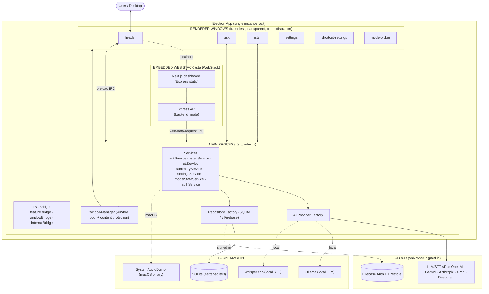

Notable startup details in `index.js`:

- **Single-instance lock** (`index.js:163`): a second launch focuses the existing window and
  forwards any `pickleglass://` deep link, then quits.
- The **Windows loopback grant** is installed before anything else in `whenReady`
  (`index.js:175-183`) — `session.defaultSession.setDisplayMediaRequestHandler` answers every
  `getDisplayMedia` request with the first screen source and `audio: 'loopback'`.
- The web stack is started **before** windows are created (`index.js:218-222`), because the
  header window loads UI that expects the API to exist.

---

## 3. The window model & "invisibility"

Every window is held in a single `Map` called `windowPool` (`windowManager.js:35`). They share
`commonChildOptions` (`windowManager.js:481-496`): `frame:false`, `transparent:true`,
`alwaysOnTop:true`, `skipTaskbar:true`, `hiddenInMissionControl:true`, and
`setVisibleOnAllWorkspaces(true, {visibleOnFullScreen:true})`.

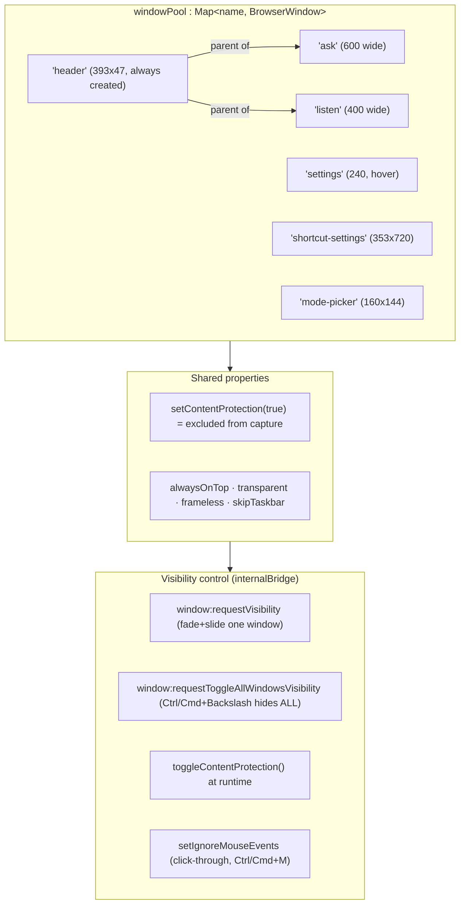

**The invisibility mechanism.** `isContentProtectionOn` defaults to `true`
(`windowManager.js:31`). Every window calls `setContentProtection(isContentProtectionOn)` at
creation (e.g. `windowManager.js:507`, `:538`, `:801`), and `setContentProtection`
(`windowManager.js:451-459`) re-applies it to the whole pool when toggled. Electron's content
protection tells the OS compositor to exclude the window from screen capture, so Glass does not
appear in screen recordings, screenshots, or screen-shares — while remaining visible on your
physical display. There's no "always-on capture" or hidden upload; the only screen grab is the
single on-demand Ask screenshot (§6).

**Lifecycle of feature windows.** Only `header` is created up front. The feature windows are
created when the header transitions to the `'main'` state (after API key / login) and destroyed
when it returns to `'apikey'`/`'permission'` (`handleHeaderStateChanged`,
`windowManager.js:859-869`; `createFeatureWindows` / `destroyFeatureWindows`,
`windowManager.js:478-701`). Position and motion are handled by `WindowLayoutManager`
(child layout relative to the header) and `SmoothMovementManager` (animated move/fade/resize).

On macOS 26+ an optional native dependency `electron-liquid-glass` adds the "Liquid Glass"
material (`windowManager.js:11-28`); it's a no-op everywhere else.

---

## 4. IPC architecture

Renderers run with `contextIsolation:true` and `nodeIntegration:false` — they have no Node or
DB access. Everything crosses the process boundary through three bridges plus the preload.

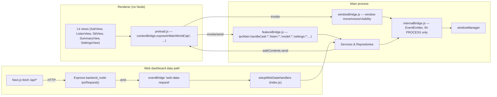

- **`preload.js`** exposes a namespaced, audited surface on `window.api` — `platform`,
  `common`, plus per-view objects like `askView`, `listenCapture`, `settingsView`, `mainHeader`
  (`preload.js:4-331`). Renderers call `ipcRenderer.invoke(...)`; they never see `require`.
- **`featureBridge.js`** registers all the feature `ipcMain.handle(...)` endpoints and
  fans service events back out to every window (`featureBridge.js:17-315`).
- **`windowBridge.js`** handles window geometry/visibility invokes.
- **`internalBridge.js`** is an in-process `EventEmitter` (`internalBridge.js`) used between
  services and `windowManager` — e.g. `internalBridge.emit('window:requestVisibility', …)`. It
  never touches the renderer.
- **Web dashboard round-trip**: the Express backend cannot read SQLite directly. It emits
  `web-data-request` over an `eventBridge`, and `setupWebDataHandlers` (`index.js:317-445`)
  services it via the same repositories, replying on a unique response channel. (See
  `docs/DESIGN_PATTERNS.md §II` for the sequence.)

---

## 5. App lifecycle

```mermaid
sequenceDiagram
    autonumber
    participant App as Electron app
    participant DB as databaseInitializer
    participant Auth as authService
    participant Model as modelStateService
    participant Web as startWebStack
    participant Win as windowManager
    App->>App: requestSingleInstanceLock() / setupProtocolHandling()
    Note over App: app.whenReady()
    App->>App: setDisplayMediaRequestHandler (Windows loopback grant)
    App->>App: initializeFirebase()
    App->>DB: initialize() — SQLite + schema/migrations
    App->>Auth: initialize() — onAuthStateChanged (default_user until login)
    App->>Model: initialize() — encryption, migrations, auto-select models
    App->>App: featureBridge + windowBridge initialize; ollama warm-up (bg)
    App->>Web: startWebStack() — free ports, Express API + Next.js static
    App->>Win: createWindows() — header, then feature windows if state='main'
    Note over App: app.on('before-quit') graceful shutdown
    App->>App: listenService.closeSession() (kill SystemAudioDump)
    App->>DB: endAllActiveSessions() + databaseInitializer.close()
    App->>App: app.exit(0)
```

Startup is `index.js:172-242`; graceful shutdown is `index.js:244-309` and is careful to stop
audio capture, end DB sessions, race Ollama shutdown against an 8 s timeout, and close DB
connections before exiting.

---

## 6. The Ask (vision) feature

**Trigger:** `Ctrl/Cmd + Enter` (`nextStep` keybind, `shortcutsService.js:68`,`:213-214`) →
`askService.toggleAskButton(true)` → `askService.sendMessage(...)` (`askService.js:221`).

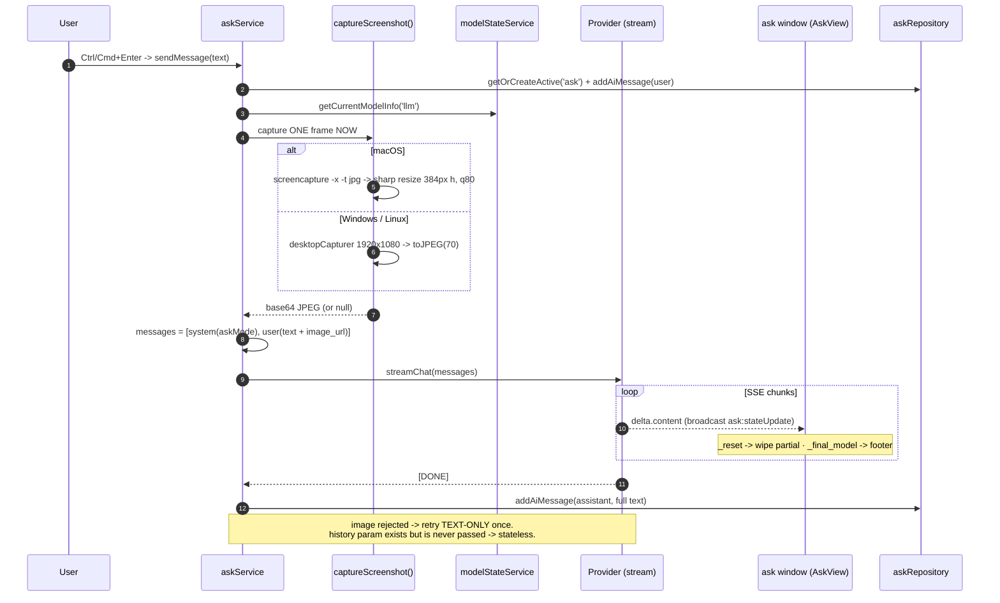

Key behaviors, all in `askService.js`:

1. **Screenshot capture** (`captureScreenshot`, `:39-121`):
   - **macOS** → native `screencapture -x -t jpg`, then `sharp` resize to **384 px height**,
     JPEG **quality 80** (`:44-67`). If `sharp` is unavailable it falls back to the raw image
     (`:73-84`).
   - **Windows / Linux** → Electron `desktopCapturer.getSources` at **1920×1080**, then
     `thumbnail.toJPEG(70)` (`:91-113`).
   - The image is base64-encoded and attached inline as a multimodal `image_url` part
     (`:301-306`).
2. **Prompt assembly** (`:259-299`): the system prompt is chosen by **Ask mode** (§13) —
   `default`, `code`, `debug`, or `system_design` — read from settings; `code` mode injects the
   preferred language token.
3. **Streaming** via `createStreamingLLM(provider, …)` (`:308-314`); SSE chunks are parsed in
   `_processStream` (`:401-474`) and broadcast to `AskView` over `ask:stateUpdate`. It also
   honors the Gemini failover sentinels `_reset` and `_final_model` (`:425-439`, see §10).
4. **Persistence**: the user prompt and the assistant response are written to `ai_messages`
   tied to the `'ask'` session (`:246`, `:467`).
5. **Multimodal fallback** (`:335-370`): if the provider rejects the image (`_isMultimodalError`
   heuristic, `:480-492`), the request is retried **text-only**, once.

**Statelessness (important).** `sendMessage(userPrompt, conversationHistoryRaw=[])` would format
the last 30 turns (`_formatConversationForPrompt`, `:207-212`) — but the IPC handlers
`ask:sendQuestionFromAsk` and `ask:sendQuestionFromSummary` call it with **only the prompt**
(`featureBridge.js:159`, `:168`). So the LLM gets *system prompt + your text + one screenshot*
and nothing else. No prior questions, answers, or screenshots are replayed.

---

## 7. The Listen (audio / STT) feature

> The authoritative deep-dive is [`docs/AUDIO_AND_STT.md`](docs/AUDIO_AND_STT.md). This section
> is the architectural summary.

Glass runs **two independent STT sessions** created in parallel at listen start
(`sttService.js:505-508`) and tags each transcript by **the channel it arrived on** — this is
**source attribution, not voice diarization** (see [§0](#0-tldr--the-questions-everyone-asks-first)).

### 7.1 Capture pipeline (dual channel)

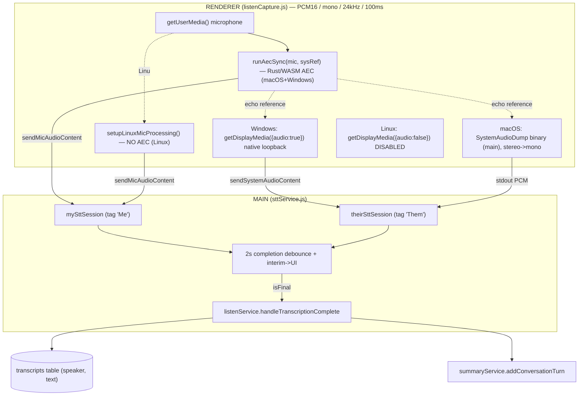

- Capture is orchestrated in the renderer by `startCapture` (`listenCapture.js:417`), which
  branches per platform. Audio is normalized everywhere to **PCM16, mono, 24 kHz, 100 ms chunks**.
- **Windows** captures both mic (`getUserMedia`) and system audio (`getDisplayMedia({audio:true})`
  → native loopback) separately (`listenCapture.js:515-565`).
- **macOS** captures mic via `getUserMedia` and system audio via the spawned `SystemAudioDump`
  binary in the main process (`sttService.js:666-757`), which is `darwin`-gated (`:667`).
- **Linux** disables system audio (`getDisplayMedia({audio:false})`, `listenCapture.js:488`) —
  mic only.
- **AEC** (acoustic echo cancellation) runs the mic through a Rust/WASM module
  (`runAecSync`, `listenCapture.js:134`) on macOS and Windows, using the system-audio stream as
  the echo reference so the other party's voice leaking from your speakers isn't double-counted
  onto `"Me"`. The Rust source is the `aec` git submodule (`.gitmodules` → `samtiz/aec.git`);
  the runtime glue is `src/ui/listen/audioCore/aec.js`. If the WASM isn't loaded, `runAecSync`
  returns the mic audio unchanged (`listenCapture.js:135`) — graceful degradation.

### 7.2 Speaker attribution (not diarization)

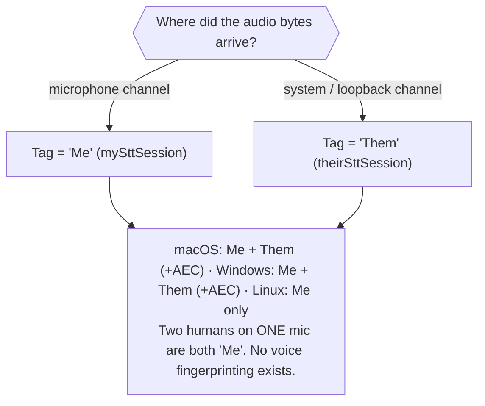

### 7.3 STT session lifecycle & resilience

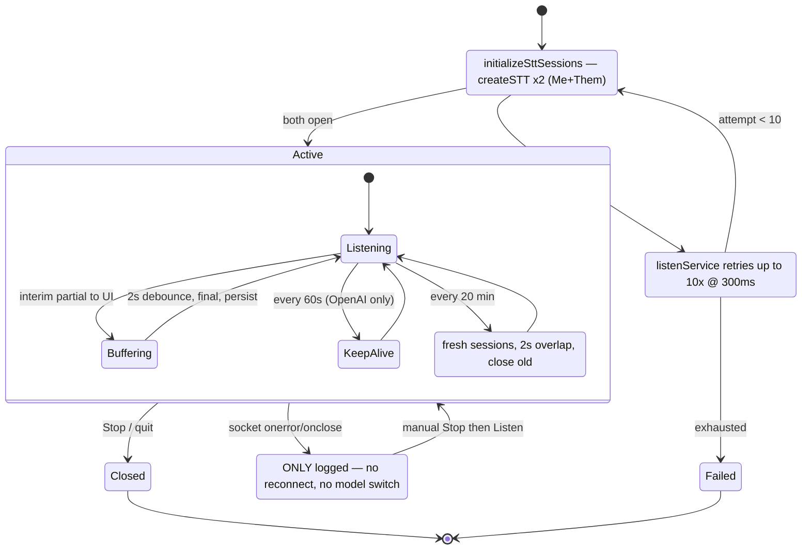

- **Init retry**: up to **10×** at 300 ms on listen start (`listenService.js:189-209`).
- **Keep-alive**: every **60 s**, OpenAI only (`sttService.js:513-516`, `:537-548`); Gemini's SDK
  self-heartbeats.
- **Proactive renewal**: every **20 min** both sessions are recreated with a **2 s overlap** so
  no audio is dropped, dodging provider hard timeouts (`sttService.js:518-527`, `renewSessions`
  `:554-581`).
- **Debounce**: finalized utterances flush through a **2 s** debounce (`COMPLETION_DEBOUNCE_MS`,
  `sttService.js:9`) before being persisted and summarized.
- **No STT failover** — by design (see §10). A socket that drops mid-session is **only logged**
  (`sttService.js:478-479`, `:487-488`); recovery requires a manual Stop → Listen.

Each finalized utterance lands in the `transcripts` table tagged with `session_id`, `speaker`,
`text`, `start_at` (`listenService.saveConversationTurn`, `:109-127`).

---

## 8. Incremental summarization

> User-facing deep-dive — what **"No insights yet…"** means, exactly when the panel fills, and
> the **interview "how do I get an answer?"** walkthrough — lives in
> [`docs/LIVE_INSIGHTS_AND_ASK.md`](docs/LIVE_INSIGHTS_AND_ASK.md).

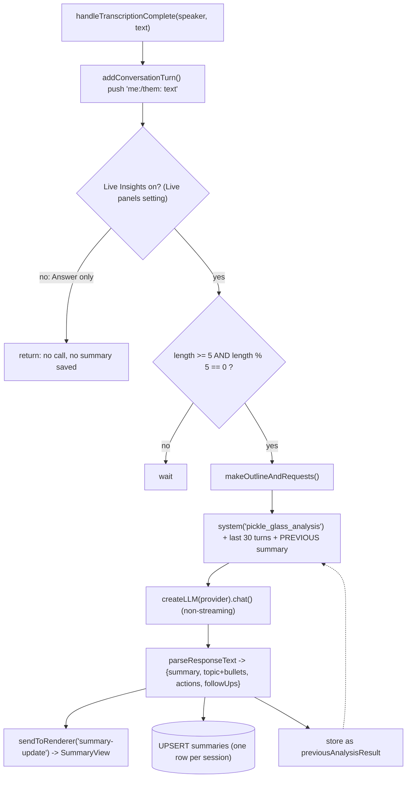

`summaryService.js` fires analysis every time the turn count hits a multiple of 5
(`triggerAnalysisIfNeeded`, `:1024`). Each run feeds the **previous analysis result** plus
the **last 30 turns** back into the prompt (`:780-783`, `:793-806`), so summaries build forward
rather than restarting. The structured output (TLDR, topic bullets, action items, suggested
follow-ups) is parsed (`parseResponseText`, `:905-1016`), pushed to `SummaryView`, and **UPSERT**ed
into the `summaries` table — one row per `session_id` (`:871-884`).

**The Live panels setting.** Settings → "Live panels" picks Answer + Insights (default), Answer
only or Insights only. It is stored as `liveFeatures` in the per-user settings store
(`settingsService.js:221`) and read through `src/features/listen/liveFeatures.js`.
`triggerAnalysisIfNeeded` returns before the every-5-turns test when Insights is off (`:1023`):
no call and no summary saved. `triggerAnswerIfNeeded` returns first when Answer is off (`:581`).
Turning Answer off mid-question also aborts the streaming answer (`pauseLiveAnswer`, `:727`).
The Settings window calls `settings:getLiveFeatures` / `settings:setLiveFeatures`
(`featureBridge.js:135-156`). The setter saves the mode, applies it to the running session through
`listenService.setLiveFeatures`, and sends `listen:liveFeaturesChanged` to the Listen window, which
hides the pane of a lane that is off. A new session reads the saved mode before its first turn.
Details: [`docs/LIVE_INSIGHTS_AND_ASK.md`](docs/LIVE_INSIGHTS_AND_ASK.md) §3.6 and §4.8.

---

## 9. AI provider abstraction & model state

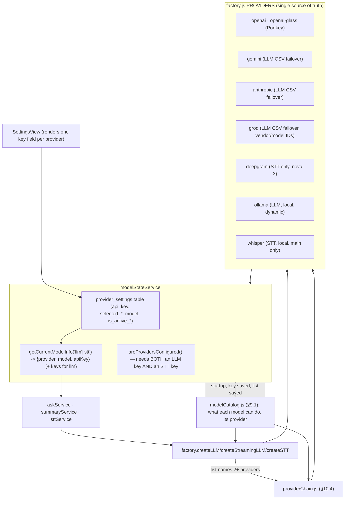

- The **registry** `PROVIDERS` (`factory.js:23-111`) declares each provider's `llmModels` and
  `sttModels`: the presets Settings offers, not what the models can do (that is the catalog,
  §9.1). The factory exposes `createSTT` / `createLLM` / `createStreamingLLM`
  (`factory.js:189-236`), normalizing the `-glass` suffix via `sanitizeModelId` (`:185`).
- **Lists across providers.** `createLLM` and `createStreamingLLM` first remove the caller's
  `keys` (`takeKeys`, `:179`), so no provider ever receives them. Then `splitByProvider` (`:160`)
  cuts the model list into runs of one provider's IDs. With one run, the call goes to that
  provider exactly as before. With two or more (e.g. three Groq models then two Gemini models),
  it goes to `providerChain.js`, which gives each provider its own key (§10.4).
- **`modelStateService`** is the single arbiter of *which* model and key are live. It stores
  keys + selections in the `provider_settings` table, auto-selects a valid model when keys
  change (`_autoSelectAvailableModels`, `:235`), maps a model ID back to its provider
  (`getProviderForModel`, `:390`: presets, then installed Ollama models, then a typed ID or CSV
  list through `inferProviderFromModelId` (`factory.js:139`): the provider whose models API lists
  the ID (§9.1); when several do, the Settings field the list was typed in; an ID no catalog has
  falls back to its prefix (`providerFromPrefix`, `:121`: `gemini-` → Gemini, `claude-` →
  Anthropic, `vendor/model` → Groq), logged once. Anthropic and Groq are LLM only; for a list,
  the first entry decides), and returns the runtime triple via `getCurrentModelInfo` (`:498`).
  For `'llm'` it also returns `keys`: the saved key of every provider the list names, or `null`
  (`_keysForModelList`, `:519`). Ask, Live Answer and Live Insights pass them to the factory.
- **Configuration gate**: `areProvidersConfigured` (`:580`) requires **both** a working LLM
  key and a working STT key — so an STT-only provider (Deepgram) or LLM-only provider
  (Anthropic/Groq/Ollama) can't satisfy the app alone.

| Provider | LLM | STT | Notes |
|---|---|---|---|
| OpenAI | ✅ `gpt-4.1` | ✅ `gpt-4o-mini-transcribe` | Realtime STT; 60 s keep-alive |
| OpenAI (Glass) | ✅ | ✅ | Pickle-hosted key via Portkey |
| Gemini | ✅ `gemini-3-flash-preview` | ✅ `gemini-3.8-live` | LLM supports CSV failover, also across providers (§10.4); STT does not |
| Anthropic | ✅ `claude-opus-5-5` · `claude-sonnet-5-5` · `claude-haiku-5-5` | ❌ | LLM only; supports CSV failover, also across providers (§10.4) |
| Groq | ✅ `openai/gpt-oss-120b` · `openai/gpt-oss-20b` · `qwen/qwen3.8-27b` | ❌ | LLM only; supports CSV failover, also across providers (§10.4); of the presets, Groq's models API says only Qwen 3.8 sees images (§9.1) |
| Deepgram | ❌ | ✅ `nova-3` | STT only (pinned to nova-3) |
| Whisper (local) | ❌ | ✅ tiny/base/small/medium | Main process only |
| Ollama (local) | ✅ (dynamic) | ❌ | LLM only |

### 9.1 Model catalog

`modelCatalog.js` (spec `2026-10-12-model-catalog`) says what each Groq, Gemini and Anthropic
model can do, and which provider an ID belongs to. It reads each provider's models API; no
table keyed by model name decides it. A new model works once its provider lists it.

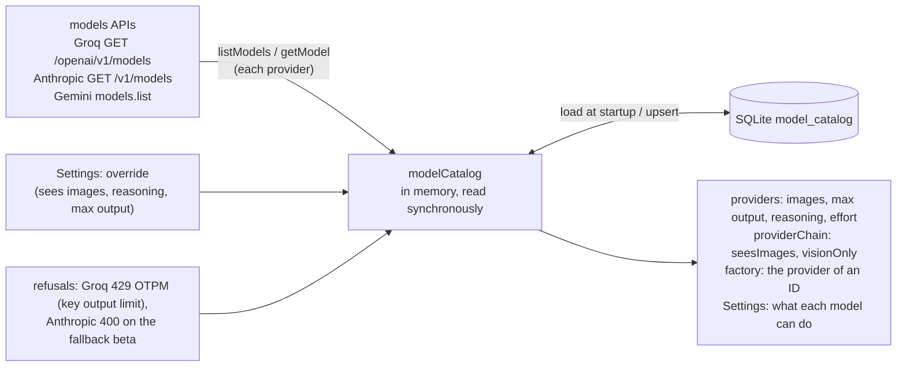

- **Resolution, per provider and ID** (`capabilities`, `modelCatalog.js:209`):
  1. the user's override, set in Settings;
  2. what the provider's models API reported;
  3. the provider default (`PROVIDER_DEFAULTS`, `:33`), one rule per provider: a Groq model
     does not see images (an image sent to a text-only model is a 400); Gemini and Anthropic
     models do. Output cap and reasoning have no default: each provider keeps its own
     behavior without one.
- **What each API reports** (each provider's `normalizeModel`; null is "not reported"):

  | Provider | Sees images | Max output | Reasoning / effort |
  |---|---|---|---|
  | Groq | `input_modalities` has `image` | `max_completion_tokens` | `supported_features` has `reasoning` |
  | Anthropic | `capabilities.image_input` | `max_tokens` | `capabilities.thinking`; the effort levels marked supported in `capabilities.effort` |
  | Gemini | not reported (provider default) | `outputTokenLimit` | `thinking` |

  Anthropic leaves out retired models (`lifecycle`); Gemini keeps the models with
  `generateContent`, and its key goes in the `x-goog-api-key` header, not the URL.
- **Learned from refusals:**
  - **Groq key output limit.** A 429 "Request too large … (OTPM): Limit L" stores L for that
    model (`recordKeyOutputLimit`, `:473`). The next request whose declared cap is over L skips
    the model with no call (§10.3). It is forgotten after 24 h and when the key changes.
  - **Anthropic server-side fallback.** A 400 on the beta method is resent once without the
    beta; when that is accepted, the model is marked as not taking it (`markServerFallback`,
    `:465`) (§10.2).
- **The provider of an ID** (`providerOf`, `:270`): the provider whose list has it; when several
  do, the context (the Settings field, or the run it continues). `factory.inferProviderFromModelId`
  falls back to the prefix only for an ID no catalog has.
- **Storage and refresh.** The `model_catalog` table (`schema.js`; one row per provider and
  model; reported fields, override columns, the learned limit, `fetched_at`) is loaded into
  memory at startup (`modelStateService._initializeCatalog`, `:38`). Every read is synchronous.
  The lists are read again:
  - at startup, in the background, for each provider with a key;
  - when a key is saved (`setApiKey`; the learned key limits are also cleared);
  - when a list is saved (`setSelectedModel` → `_learnModelList`, `:63`: up to 5 s, so Settings
    shows the result right after Save);
  - when a request names an ID the catalog does not know (`ensureKnown`, `:413`: the chain and
    each provider wait at most 2 s, then go on with the defaults while the lookup finishes in the
    background). A list older than 24 h is read again in the background.

  A failed read keeps what is known. An ID the list does not name (an alias) is looked up
  alone (`getModel`); an ID the provider does not have is recorded as missing and checked
  again after 24 h.
- **Settings** (`SettingsView.renderModelCapabilities`): under the field that holds the active
  list, one line per model: its provider, what it can do with the source of each value
  (`override` or `default` when not from the API), and warnings ("no model with this ID", the key
  output limit, "answers may stop at N tokens" under Ask's 16,384). **Edit** sets an override
  (sees images and reasoning: Auto / Yes / No; max output: a number). **Refresh** reads the lists
  again. The renderer keeps no rule of its own: it validates and lays out a list through
  `model:plan-model-list` (`modelStateService.planModelList`, `:82`).
- **What stays in code:** the provider defaults above; the Groq reasoning dialect (§10.3: which
  fields a reasoning family takes, which no API reports); the preset lists in `PROVIDERS`; and
  the per-name timeout tuning of Gemini Lite and Claude Haiku (latency, overridable by env).
- **IPC** (`featureBridge.js`): `model:get-catalog`, `model:plan-model-list`,
  `model:set-capability-override`, `model:refresh-catalog`; `model:set-selected-model` also
  takes `fieldProvider`.

---

## 10. Failover: Gemini, Anthropic, Groq and across providers

### 10.1 Gemini

A headline feature of this fork (full design in
[`specs/2026-05-26-gemini-failover-design/`](specs/2026-05-26-gemini-failover-design/)). The
Gemini LLM model field accepts a **comma-separated priority list** (e.g.
`gemini-3-flash-preview,gemini-3.5-flash-lite,gemini-3.1-flash-lite`). On a *transient* error the current model
is cooled down and the next is tried; the model that actually answered is shown in a per-response
footer (`answered by: <model>`, with `(fallback)` if a retry occurred).

```mermaid
flowchart TB
    start(["createStreamingLLM / createLLM with model CSV"]) --> parse["parseModelList(csv) -> remaining[]"]
    parse --> pick["pickModel: first healthy; else soonest-to-recover"]
    pick --> call["attempt model"]
    call --> hedge{"Flash-Lite, no chunk after 10 s?"}
    hedge -->|yes| race["streaming: parallel request to the same model; first chunk wins, other aborted"] --> ok
    hedge -->|no| ok{"success?"}
    ok -->|yes| done["markSucceeded; emit _final_model footer"] --> finish(["[DONE]"])
    ok -->|error| classify["classifyError: status -> errorDetails -> message"]
    classify --> kind{"kind?"}
    kind -->|fatal-auth 401/403| fatal["surface immediately"]
    kind -->|fatal-request 400| fatal
    kind -->|transient 408/429/5xx, network, first-chunk timeout| cool["markFailed: timeout 10 s; else parseRetryAfter, 5s..300s"]
    cool --> reset["streaming: emit {_reset, next_model} -> consumer wipes partial"]
    reset --> more{"models left?"}
    more -->|yes| pick
    more -->|no| round{"streaming, round 1, and some failed fast (not 429 / timeout)?"}
    round -->|yes| retry["emit {_reset, reason: retry}; wait 3 s; retry those models"] --> pick
    round -->|no| allfail["controller.error(lastErr)"]
```

- The health registry is an **in-memory singleton** `Map` (`modelHealth.js:17`, shared with the
  Anthropic and Groq providers, read by the cross-provider chain through `isCoolingDown` (§10.4),
  and re-exported by `geminiModelRotator.js`) — one
  shared rate-limit view per process; it resets on restart (cooldowns are clamped to ≤ 300 s, so
  nothing meaningful is lost).
- `classifyError` (`geminiModelRotator.js:33-69`) inspects HTTP status → `errorDetails[]`
  `ErrorInfo.reason` → message-text heuristics, defaulting **fail-open** to `transient` so the
  loop keeps trying on unknown errors. `transient` = 408/429/5xx, network, `RESOURCE_EXHAUSTED` /
  `UNAVAILABLE` / `DEADLINE_EXCEEDED`; `fatal-request` = 400/`INVALID_ARGUMENT` (catches CSV
  typos); `fatal-auth` = 401/403/`API_KEY_INVALID`.
- Cooldown honors `Retry-After` / `retryDelay`, defaults to 60 s, clamped to `[5 s, 300 s]`
  (`parseRetryAfter`, `:87-130`; constants `modelHealth.js:19-21`).
- **Streaming** emits a `_reset` sentinel so the Ask consumer discards the partial answer before
  the next model streams in, then a `_final_model` sentinel (`gemini.js:772-921`); the Ask
  consumer applies both through the pure reducer `applyAskSseEvent` (`askStreamState.js:42-70`),
  which also keeps `isLoading` ("Thinking...") on until the first token and exposes
  `retryingWith` (the `next_model` of the last `_reset`) so the Ask header can show
  "Thinking... trying <model>".
- **First-chunk timeout:** a request can be accepted and then stall (~96 s observed) before the
  first chunk. Each request gets an `AbortController` passed to `generateContentStream` as
  `{ signal }`; if no chunk arrives in time the attempt is aborted, logged as `outcome=timeout`,
  and a `_reset` with `reason: 'timeout'` moves on to the next model. Budget per model
  (`firstChunkTimeoutMs`, `gemini.js:240-244`): 25 s for Lite models, 60 s for models that
  think before answering; `GEMINI_FIRST_CHUNK_TIMEOUT_MS` overrides it for every model. Only the
  first chunk is timed — a slow stream after that is never cut off. A timed-out model is cooled
  down for only `TIMEOUT_COOLDOWN_MS` (10 s, `:160`): a stall is specific to one request, and the
  60 s default had pushed the next requests onto worse models. "Lite" is decided by
  `isLiteModel` (`:127-129`): a `lite` segment anywhere in the ID, so suffixed IDs such as
  `gemini-2.5-flash-lite-preview-06-17` or `gemini-flash-lite-latest` count too.
- **Hedged (parallel) request:** within an attempt, a request that has sent nothing after
  `hedgeDelayMs(modelId)` (`gemini.js:259-266`; 10 s for Lite models, none for other models)
  gets a second request to the **same** model (`raceFirstChunk`, `:550`). On 2026-10-06 a fresh
  request to a model that had just stalled usually answered in a few seconds. The first request
  to yield a chunk is streamed and the other is aborted, so the consumer never sees it. The
  attempt's deadline still counts from its start, so the worst case per model is unchanged. An
  error before the hedge starts fails the attempt at once; after it, the other request is still
  awaited. Only Flash-Lite, because Flash's free tier allows 20 requests a day and thinking models
  are silent for long stretches by design. `GEMINI_HEDGE_DELAY_MS` overrides the delay for every
  model (`0` disables, `1` forces a hedge for manual testing); `createStreamingLLM` takes
  `hedgeDelayMs` (`null` disables).
- **End of the answer:** an attempt ends at the chunk that carries `candidates[0].finishReason`,
  not when the HTTP response closes (`gemini.js:753-756`). The server was seen keeping the
  connection open ~7 s after a complete answer; the attempt now counts as `ok` right away
  (`_final_model` + `[DONE]` are sent, Ask stops streaming and saves) and the leftover
  connection is aborted.
- **Request deadline:** a streaming request gives up when no answer has started within
  `REQUEST_DEADLINE_MS` (60 s, `gemini.js:275`), counted from the request start across every
  attempt, hedge and the second round. Each attempt's timeout is shortened to what is left, the
  second round is skipped when less time is left than its wait, and the error reads `No answer
  within 60s (N attempts). Last: <model> — <reason>`. Once any chunk has arrived the deadline no
  longer applies, so a long answer is never cut. Without it, a list like
  `3.5-flash-lite,3.1-flash-lite,3-flash-preview` could wait 25 + 25 + 60 s before a second round.
  `GEMINI_REQUEST_DEADLINE_MS` overrides it (`requestDeadlineMs()`, `:185-192`; `0` disables);
  `createStreamingLLM` takes `requestDeadlineMs` (`null` disables).
- **Second round:** when every model fails in the streaming path, the models whose failure was
  quick and transient get one more try after `RETRY_ROUND_DELAY_MS` (3 s; `MAX_ROUNDS = 2`,
  `gemini.js:297-298`). `retryableNextRound` (`:308-312`) leaves out first-chunk timeouts (25-60 s
  each) and 429s (quota; retrying seconds later only burns quota), so 500/502/503/504 and
  network errors qualify. The round is announced with `_reset` `{ reason: 'retry', next_model }`
  (the Ask header shows "Thinking... trying <model>" during the wait), logged as
  `all models failed — retry round 2 in 3000ms: a,b`, and the wait is cancellable.
  `createStreamingLLM` takes `retryRoundDelayMs` to change the wait. The non-streaming
  `callWithFailover` keeps a single round (it serves the Listen summary, which runs again on
  its next cycle).
- **Cancellation:** the stream's `cancel()` aborts every in-flight request (both sides of a hedged
  attempt, or the wait between rounds) and stops failover
  (logged `outcome=aborted` + `request ... cancelled`; `answered_by` names the model when text had
  already arrived, `none` otherwise). Ask cancels when the window closes or a new
  request replaces the current one; Live Answer cancels when a newer question supersedes it.
- **Live Answer status:** Live Answer has no "Thinking..." header, so `summaryService` sends
  status payloads on `live-answer-update`: `retrying` (with the `next_model` of each `_reset`),
  `idle` when that answer's stream ends, and `error` with the `userMessage` (or `The model
  returned an empty response.`). `applyLiveAnswerStatus` (`liveAnswerHistory.js`) turns them
  into one line under the "Live Answer" eyebrow: "Trying <model>…" or "No answer — <reason>"
  (see [`docs/LIVE_INSIGHTS_AND_ASK.md`](docs/LIVE_INSIGHTS_AND_ASK.md) §4.3).
- **Errors for display:** when every model fails, or on a fatal error, the error passed to
  `controller.error()` carries a short `userMessage` (e.g. `All Gemini models failed (5 attempts,
  2 rounds). Last: gemini-3-flash-preview — [503 Service Unavailable] ...`). `askService` puts it in
  `state.errorMessage` (also `The model returned an empty response.` when a stream ends with no
  text) and the Ask window renders it instead of an empty "...".
- **Diagnostics:** every attempt logs one line to the main-process console (`logAttempt`,
  `gemini.js:183-200`) with model, outcome (`ok` / `aborted` / `timeout` / `transient` / `fatal-*`),
  HTTP status, when the hedged request started (`hedge=`) and which request answered (`winner=first|hedge`),
  time to first chunk (`ttft`), time of the last chunk (`last`; `total - last` is how
  long the connection stayed open after it), total time, chunk count, `finish` reason, token usage
  (`thoughts` = thinking tokens) and the server's error reason; each request ends with a summary
  line (`logRequest`, `:331-334`, with `hedges=N` when any) whose
  `total` includes the time spent on failed attempts. Grep the `npm start` terminal for
  `[Gemini Provider]`:
  `attempt 1/5 stream model=gemini-3.8-flash outcome=transient status=503 total=4210ms error="..."`.
- **What the model takes** comes from the model catalog (§9.1). `maxOutputTokens` is the
  caller's cap, else 65,536, never over the model's `outputTokenLimit` (`maxOutputTokensFor`,
  `gemini.js:76`). Gemini's models list does not say which models see images, so every model
  does by default; one set otherwise in Settings gets the request without the image, and goes
  after the ones that see it. With `visionOnly` (the chain, §10.4), only the models that see
  images are tried (`planModels`, `:87`; none: `NO_VISION_MODEL`, no request).
- **STT deliberately does NOT fail over** — `createSTT` takes only the first model in the list
  (`gemini.js:135-137`), because a persistent live STT session has no clean rotation semantics
  (locked decision #3 in the spec).

### 10.2 Anthropic (Claude)

Since 2026-10-11 the Anthropic provider has the same failover contract (full design in
[`specs/2026-10-11-anthropic-provider-resilience/`](specs/2026-10-11-anthropic-provider-resilience/);
diagram [`docs/diagrams/15-anthropic-failover.mmd`](docs/diagrams/15-anthropic-failover.mmd)).
Settings has an **Anthropic LLM Model ID** field under the Anthropic key, which takes a
comma-separated list of `claude-…` IDs (e.g. `claude-haiku-5-5,claude-sonnet-5-5`). The presets
are `claude-opus-5-5` (the default), `claude-sonnet-5-5` and `claude-haiku-5-5`. The consumers
are unchanged: they read the same `_reset`, `_final_model`, `[DONE]` and `userMessage`.

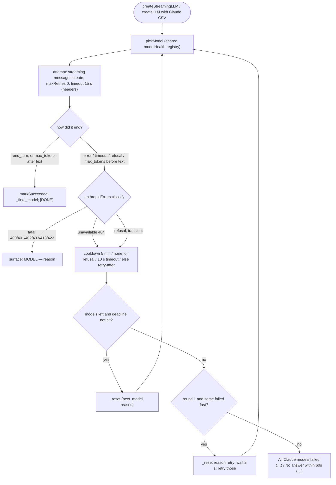

- **One loop, both shapes:** `runWithFailover` (`anthropic.js:621-754`) serves `streamChat` and
  `chat` / `generateContent`. Every Messages call **streams**, the non-streaming lanes included:
  a non-streaming response sends its headers only when the whole answer is written, so the SDK's
  15 s timeout would cut it. `chat()` joins the text and returns `_modelUsed`.
- **The SDK never retries** (`maxRetries: 0`, `anthropic.js:269`). It would wait out the
  server's `retry-after` inside the attempt, however long. A transient failure moves to the next
  model at once. When every model has failed fast, they get one more round after
  `RETRY_ROUND_DELAY_MS` (2 s, `:373`), announced with `_reset` `reason: 'retry'`. Timeouts,
  refusals and 404s stay out of it, and so does a 429 whose `retry-after` is longer than the wait
  (`joinsNextRound`, `:445`). The round is skipped when the request deadline leaves less than the
  wait.
- **Requests** (`buildRequest`, `anthropic.js:186`, pure). What the model takes comes from the
  model catalog (§9.1), that is the Models API or an override in Settings:
  - It never sends `temperature`, `top_p`, `top_k` or `thinking`. Every lane passes
    `temperature: 0.7`, and Opus, Sonnet and Haiku 5.5 reject a non-default value with a 400.
  - `output_config.effort` is sent only to a model whose `capabilities.effort` lists levels
    (`effortLevels`, `:32`; Haiku 4.5 and Sonnet 4.5 reject effort with a 400). The level is the
    caller's, else `ANTHROPIC_EFFORT`, else `low`, among the model's levels. A model the catalog
    does not know gets no effort.
  - On a model that thinks (it has effort levels, or the catalog does not know it) `max_tokens`
    is at least 4096, since thinking counts toward it and Live Answer passes 900. It never goes
    over the model's `max_tokens` from the Models API.
  - A model set not to see images gets the request without them (`images=dropped:N` in the log).
    With `visionOnly` (the chain, §10.4), those models are left out, and when none sees images
    the request fails with `NO_VISION_MODEL` before any call.
  - Consecutive messages with the same role are merged.
  - `generateContent` never promotes a "You are…" string to the system prompt.
- **Server-side refusal fallback:** every request goes through `beta.messages.create` with
  `fallbacks: 'default'` (beta `server-side-fallback-2026-07-01`), unless the catalog records
  that the API refused the beta for that model. A `fallback` block mid-stream is not a failure:
  no `_reset`, and `_final_model` names the model that finished. A 400 on the beta method is
  resent once without the beta (`openStream`, `:481`). When that is accepted, the beta was the
  cause (an org or a model without it): the catalog marks the model (`server_fallback = 0`,
  kept across restarts) and it is not sent the beta again. When the resend fails too, its error
  is the attempt's and nothing is recorded. A final `stop_reason: refusal` fails over to the
  next model in the list, with no cooldown.
- **Errors** (`anthropicErrors.js`). `classify` (`:44`) checks the provider's own codes first,
  then the HTTP status, then the error type (`err.type`, also set on stream `error` events),
  and treats anything unknown as transient (fail-open):

  | Kind | What triggers it | Cooldown |
  |---|---|---|
  | transient | 408/409/429/5xx/529, network, mid-stream `overloaded_error` | `retry-after`, else 60 s, clamped to 5 s–5 min |
  | transient (provider's own) | first-text or idle timeout, `max_tokens` before any text | 10 s |
  | unavailable | 404 (retired, or not enabled for the key) | 5 min |
  | refusal | `stop_reason: refusal` | none |
  | fatal-request | 400/413/422 | none; surfaces at once |
  | fatal-auth | 401/402/403 | none; surfaces at once |
- **Timeouts:**
  - First text within `firstTextTimeoutMs` (`:177`): 20 s for the Haiku family, 45 s for the
    others. Thinking streams silently, and the SDK drops pings.
  - Once text streams, 30 s without any stream event aborts the attempt.
  - An answer must start within the 60 s request deadline, counted across all attempts. Once
    it has started, the deadline no longer applies.
  - The attempt stops reading at `message_stop` and closes the connection.
  - The SDK ends an aborted stream without throwing, so a timeout is read from the attempt's
    own flag.
- **Cancellation:** `cancel()` aborts the in-flight request or the wait between rounds, with no
  failover and no error (`outcome=cancelled`, `request … cancelled`).
- **Key validation** lists one model (`models.list({ limit: 1 })`). It costs nothing and names no
  model, so a retirement cannot break it.
- **Diagnostics:** grep `[Anthropic Provider]`, e.g. `attempt 2/2 stream model=claude-haiku-5-5
  outcome=ok ttft=840ms last=2100ms total=2110ms chunks=31 stop=end_turn
  tokens=in:1200,out:310,cache_read:0 request_id=req_…`. The line adds `fallback=<from>→<to>` or
  `served_by=` when another model answered, and `category=` on a refusal. No log line carries
  prompt or answer text.
- **Tuning (`.env`, all optional):**

  | Variable | Default | Effect |
  |---|---|---|
  | `ANTHROPIC_EFFORT` | `low` | Effort level: `low`, `medium`, `high`, `xhigh` or `max` |
  | `ANTHROPIC_MIN_MAX_TOKENS` | 4096 | `max_tokens` floor on models that think |
  | `ANTHROPIC_FIRST_TEXT_TIMEOUT_MS` | 20000 (Haiku) / 45000 | Per-attempt wait for the first text |
  | `ANTHROPIC_REQUEST_DEADLINE_MS` | 60000 | Wait for an answer to start; `0` disables |
  | `ANTHROPIC_IDLE_TIMEOUT_MS` | 30000 | Silence allowed once text streams; `0` disables |
  | `ANTHROPIC_SERVER_FALLBACK` | on | `off` stops the server-side refusal fallback |
- **STT:** Anthropic has none. Pair it with Gemini, Deepgram, OpenAI or Whisper for Listen.

### 10.3 Groq

Since 2026-10-12 the Groq provider has the same failover contract (full design in
[`specs/2026-10-12-groq-provider/`](specs/2026-10-12-groq-provider/); diagram
[`docs/diagrams/16-groq-failover.mmd`](docs/diagrams/16-groq-failover.mmd)). Settings has a
**Groq LLM Model ID** field under the Groq key. It takes a comma-separated list of `vendor/model`
IDs, e.g. `openai/gpt-oss-120b,openai/gpt-oss-20b,qwen/qwen3.8-27b`.

The presets are the three chat models active on a Free-plan key in October 2026:
- `openai/gpt-oss-120b`, the default;
- `openai/gpt-oss-20b`;
- `qwen/qwen3.8-27b`, a preview model, and the only one of the three that sees images (Groq's
  models API reports it; §9.1).

The loop is modelled on §10.2 and speaks the same protocol to the consumers.

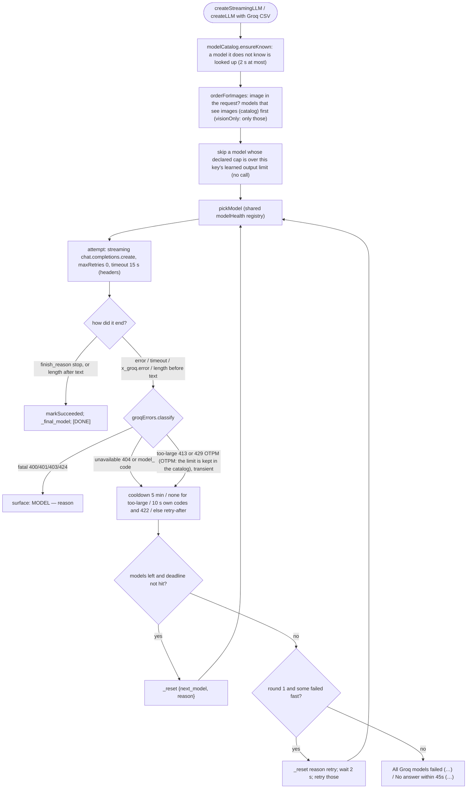

- **Same shape as Anthropic:** one `runWithFailover` (`groq.js:608-769`) for `streamChat` and
  `chat` / `generateContent`; every call streams; the SDK never retries (`SDK_MAX_RETRIES`,
  `:282`); one more round after 2 s for fast transient failures (`joinsNextRound`, `:459`);
  cancellation aborts the request or the wait.
- **Requests** (`buildRequest`, `groq.js:187`, pure; `modelTraits`, `:28`). Whether a model sees
  images, its output maximum and whether it reasons come from the model catalog (§9.1): Groq's
  `input_modalities`, `max_completion_tokens` and `supported_features`, or an override in
  Settings. A model the catalog does not know gets no image and no cap.
  - Reasoning is set per family (`REASONING_DIALECTS`, `:16`), the one table by model name that
    stays: the API says only that a model reasons, not which fields it takes, and a field a
    model does not know is a 400. It applies unless the catalog says the model does not reason:
    - gpt-oss gets `reasoning_effort: 'low'` and `include_reasoning: false`, so the reasoning
      text never reaches the app or the logs;
    - qwen3 gets `reasoning_effort: 'none'` (instruct mode), plus `reasoning_format: 'hidden'`
      at any other effort;
    - a model of no known family gets no reasoning field, and reasons at its own default.
  - `temperature` is passed through when it is within [0, 2].
  - `max_completion_tokens` is the caller's cap (else 16,384) plus 1024 for reasoning on models
    that reason, capped at the model's maximum. Reasoning counts toward it. Only Ask sets no
    cap: its code and system design answers run to thousands of tokens (4,204 measured), and
    an Ask answer must not stop mid-way. Groq does not meter the declared value against the
    per-minute limit, only the tokens used, with one exception: on a key with a separate
    output limit (OTPM), Qwen refuses before running a request whose expected output, which
    Groq derives from the declared cap, is over that limit (research R20).
  - Images go only to a model that sees them, at most 3. A request with an image tries those
    models first (`orderForImages`, `:166`; log `order=vision-first`), then text-only models
    without the image (`images=dropped:N`). With `visionOnly`, which the chain sets when a
    later provider sees the image (§10.4), only the models that see it are tried. When they
    fail, or the list has none (`NO_VISION_MODEL`, no request sent), the request fails rather
    than answer without the image.
  - **The key's output limit** (learned, §9.1). A 429 OTPM stores the limit L for the model.
    Until it expires (24 h) or the key changes, a request whose declared cap
    (`declaredMaxTokens`, `:219`) is over L skips that model with no call (log
    `skip model=… reason=key-output-limit limit=L requested=R`). Live Answer (900) still runs on
    Qwen. When every candidate is skipped, the request fails with `KEY_OUTPUT_LIMIT` and the
    output-token message, and the chain moves to the next provider.
- **Stream reading:**
  - The attempt stops at the chunk that carries `finish_reason` and closes the connection.
    groq-sdk keeps reading past `[DONE]` until the server closes it.
  - `delta.reasoning` is ignored.
  - A chunk with `x_groq.error` fails the attempt (`STREAM_ERROR`). The string itself is
    never logged.
- **Errors** (`groqErrors.js`). groq-sdk keeps the whole body on HTTP errors and the inner
  object on stream errors. `classify` (`:68`) reads both:

  | Kind | What triggers it | Cooldown |
  |---|---|---|
  | transient | 408/409/429/498/5xx, network, mid-stream `{"error"}` | `retry-after`, else 60 s, clamped to 5 s–5 min |
  | transient (short) | first-text or idle timeout, `length` before any text, `x_groq.error`, 422 | 10 s |
  | unavailable | 404, or any `model_…` code (not found, decommissioned, blocked) | 5 min |
  | too-large | 413 "Request too large … (TPM): Limit L, Requested R", or 429 "Request too large … (OTPM)" (output tokens per minute) | none; never retried in round 2 |
  | fatal-request | 400/424 | none; surfaces at once |
  | fatal-auth | 401/403 | none; surfaces at once |
- **Timeouts:** first text within 15 s (`firstTextTimeoutMs`, `:245`); 15 s idle once text
  streams; an answer must start within 45 s.
- **Rate limits:** a Free-plan key has 8K tokens per minute and 200K per day **per model**.
  Cached tokens do not count, and Live Answer and Live Insights share the fixed ~2.4K-token
  prefix of `pickle_glass_analysis`. One Live Answer is about 3.5K and one Live Insights about
  2.5K, so a one-hour interview uses about 240K of the 400K the two text models share
  (estimate in the spec's research R5): one interview fits, two in a day probably do not. The list
  spreads load across models. Each attempt logs `tpm_left` (`x-ratelimit-remaining-tokens`), and a
  413 tells the user the request is over the limit. Since October 2026 the console also splits
  the 8K of Qwen and gpt-oss-120b into 7K in / 1K out. Only Qwen enforces the 1K: it refuses a
  request whose expected output is over 1,000. Groq derives that estimate from the declared
  cap: 1,001 for 1,001, 1,168 for 16,384. So Qwen serves Live Answer (900) but not Ask
  (16,384) or Live Insights (1,024). gpt-oss wrote 4,204 output tokens in one answer
  (research R20).
- **Key validation** lists models (`models.list()`). Keys start with `gsk_`. The same list feeds
  the model catalog (`listModels`, `:320`; inactive models left out).
- **Diagnostics:** grep `[Groq Provider]`, e.g. `attempt 1/3 stream model=openai/gpt-oss-120b
  outcome=ok ttft=310ms last=1900ms total=1910ms chunks=42 stop=stop effort=low
  tokens=in:6100,out:520,reasoning:180,cached:2300 queue=90ms tpm_left=1400 request_id=req_…`.
  A request-too-large refusal adds `limit=L requested=R`, which the 160-character `error=`
  cuts off. No log line carries prompt, answer or reasoning text.
- **Tuning (`.env`, all optional):**

  | Variable | Default | Effect |
  |---|---|---|
  | `GROQ_REASONING_EFFORT` | gpt-oss `low`, qwen3 `none` | gpt-oss: `low`/`medium`/`high`; qwen3: `none`/`default`/`low`/`medium`/`high` |
  | `GROQ_MAX_TOKENS` | 16384 | Answer budget when the caller gives none (Ask) |
  | `GROQ_REASONING_TOKENS` | 1024 | Extra budget on models that reason |
  | `GROQ_FIRST_TEXT_TIMEOUT_MS` | 15000 | Per-attempt wait for the first text |
  | `GROQ_REQUEST_DEADLINE_MS` | 45000 | Wait for an answer to start; `0` disables |
  | `GROQ_IDLE_TIMEOUT_MS` | 15000 | Silence allowed once text streams; `0` disables |

  `GROQ_BASE_URL`, if set, redirects the SDK; leave it unset.
- **STT:** none. Groq's Whisper is batch-only, and Listen needs a real-time session.

### 10.4 Lists across providers

Since 2026-10-12 one model list may name several providers (full design in
[`specs/2026-10-12-cross-provider-failover/`](specs/2026-10-12-cross-provider-failover/); diagram
[`docs/diagrams/17-cross-provider-chain.mmd`](docs/diagrams/17-cross-provider-chain.mmd)). When
every model of one provider fails, for example when Groq's free daily budget runs out
mid-interview, the next provider's models answer in Ask, Live Answer and Live Insights.

The list is typed in the **first provider's** model field and stored in that provider's row, as
any list is. For example, in the Groq field:

`openai/gpt-oss-120b,openai/gpt-oss-20b,qwen/qwen3.8-27b,gemini-3.5-flash-lite,gemini-3.1-flash-lite`

The first entry decides the active provider, as before. A list that starts with `claude-…`
goes in the Anthropic field. After the first entry, another provider's models can go **in any
position, and more than once**. Settings accepts them only when that provider's key is saved.
So the rule need not be remembered, Settings shows it under each model field:
- the help line states it ("Mixing providers: put the whole list in the field of its first model…");
- the field that holds the active list shows the order it runs in, e.g. "Active list, tried in this order: Groq (3 models) → Gemini (2 models)", and flags a provider with no saved key ("no API key: skipped");
- the other fields say where the active list is, and that saving there makes their provider the active one.

These notes come from `SettingsView.modelListOrder`, which cuts the saved list the same way as `factory.splitByProvider`.
The order of the list is the order of priority, left to right.

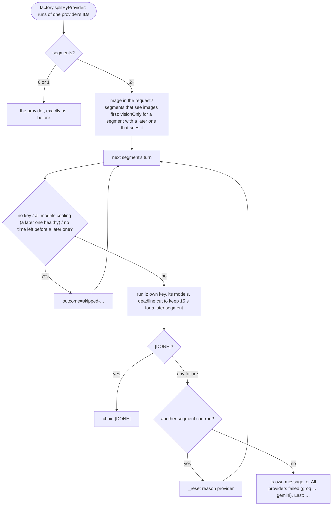

- **Segments** (`factory.splitByProvider`, `factory.js:160`, pure). Consecutive IDs with the same
  prefix provider form one segment. An ID with no known prefix joins the current segment, so
  the provider tries it as before. An ID's provider is the one whose models API lists it (the
  model catalog, §9.1), else its prefix. Only Anthropic, Gemini and Groq lists are cut; OpenAI and
  Ollama lists never are. An interleaved list (`groq, gemini, groq`) gives three segments.
- **Composition, not a new loop.** `providerChain.js` calls each segment's provider through its
  public `createStreamingLLM` / `createLLM`, so every provider keeps its own failover, cooldowns,
  rounds, timeouts and image routing (§10.1–10.3). The only option the chain adds is
  `visionOnly` (see Images below). Before the plan, it lets the model catalog learn every
  segment's models (`ensureKnown`, 2 s at most; §9.1). The module never calls an SDK, and loads
  a provider only when one of its segments runs.
- **Stream protocol.** The running segment's events pass through unchanged: deltas, its own
  `_reset`s and `_final_model`. Its `[DONE]` becomes the chain's `[DONE]`. When a segment fails
  and another can run, the chain sends `{ _reset: true, next_model, reason: 'provider' }`, where
  `next_model` is the model that segment will try first. The consumers already show
  "Trying <model>…", discard any partial answer, and mark the answer "(fallback)".
- **The chain switches only when a provider as a whole gives up.** Intermittent errors are handled
  first by that provider's own failover: its other models, its cooldowns, and its second round.
  A segment fails when its stream errors, ends without `[DONE]`, or its call throws. Then the
  chain moves on whatever the cause, a 401, 400 or 413 included, because keys, limits and request
  rules differ per provider. Only a cancel stops the chain.
- **How each failure is handled**, with Groq first (its rules, §10.3; Gemini and Anthropic apply
  their own, §10.1–10.2):

  | Situation | What happens |
  |---|---|
  | 429, 503 or timeout on one Groq model | Groq tries its next model. The next provider is not called |
  | Fast failures on every Groq model (5xx, network, a per-minute 429 whose `retry-after` fits in 2 s) | Groq waits its 2 s and gives them a second round. Only if they fail again does the next provider take over |
  | Daily 429 (budget spent) | No second round: the hint is minutes. The next provider takes over in under a second |
  | Timeouts on every Groq model | No second round (a timeout already cost seconds). The next provider takes over |
  | 413, or a 429 on output tokens (OTPM): request too large | Groq's next model (no cooldown), then the next provider |
  | A screenshot, and a later provider sees images | Groq tries only Qwen (`visionOnly`). If Qwen is refused, e.g. over its 1K output limit, the next provider answers with the image; gpt-oss never answers without it. The limit is then kept: the next screenshot skips Qwen with no Groq request |
  | 401, 403, 400 (bad key or request) | Groq stops at once, since every model shares the key and the rules. The next provider takes over; without the chain this would end in an error |
  | Groq started answering, then failed | The partial answer is discarded (`_reset`), and the next provider answers from scratch with no chain deadline |
  | The stream ended without `[DONE]` | Treated as a failure: the next provider |
  | The next provider has no saved key | It is skipped; the one after it runs, if any |
  | A newer question replaced this one (cancel) | The running request is aborted. Nothing else starts and no error is shown |

  **Cooldowns decide whether the next request skips Groq.** Each failed Groq model cools down:
  - a per-minute 429: the server's hint, at least 5 s;
  - a timeout or a 422: 10 s;
  - a 503 or a network error with no hint: 60 s;
  - a daily 429, or a model not available to the key: 5 min (the registry's ceiling);
  - a 413, or a 429 on output tokens (OTPM): none.

  While **every** Groq model is cooling down, later requests go straight to the next provider
  with no Groq request (`skipped-cooling`). If only some are, Groq runs and uses the healthy ones.
- **Skips** (decided when a segment's turn comes; logged, no request):
  - `skipped-no-key`: its provider has no saved key;
  - `skipped-cooling`: every one of its models is cooling down in the shared registry
    (`modelHealth.isCoolingDown`), and a later segment with a key has a model that is not. A
    spent Groq (daily 429, "try again in 6m11s") therefore costs one fast pass of 429s on the
    first request, then nothing until a 5-minute cooldown ends. One probe then tells whether its
    budget has refilled. If every segment is cooling down, they run in order;
  - `skipped-deadline`: see below.
- **Time.** An answer must start within `LLM_CHAIN_DEADLINE_MS` (60 s) across segments.
  - A segment with a later one behind it gets `requestDeadlineMs` = min(its provider's own
    deadline, time left − 15 s).
  - The chain never changes a provider's wait before its second round: 2 s for Groq and
    Anthropic, 3 s for Gemini. A 1–2 s overload therefore still resolves on the provider the
    user put first. This was a review decision; the first build passed `retryRoundDelayMs: 0`.
  - When that comes to 0 or less, the segment is skipped.
  - The last segment gets what is left.
  - Once answer text has been forwarded, no chain deadline applies.
  - **With three providers, the middle one depends on how the first one failed.** Groq's own
    deadline is 45 s, the same as 60 s − 15 s:
    - Groq fails fast, e.g. spent with 429s in under a second: the middle provider gets about
      44 s and the last about 59 s.
    - Groq stalls until its 45 s deadline: 15 s are left, so the middle provider gets 0 and is
      skipped (`skipped-deadline`), and the last answers with 15 s.

    Checked over fake providers with an injected clock (spec research R13).
- **Images.** With an image in the request, segments that see images go first (stable order).
  A segment sees images when one of its models does, by the model catalog (`seesImages` in
  `adapterFor`, `providerChain.js:72`; §9.1): for Groq, a model whose `input_modalities` has
  `image` (today `qwen/qwen3.8-27b`); Gemini and Anthropic models do by default, unless an
  override in Settings says otherwise. The request line then carries `order=images-first`.
  - A segment followed by another one (with a key) that sees images runs with `visionOnly`
    (`decideTurn`, `providerChain.js:248`). Every provider then tries only its models that see
    the image, and fails rather than let another model answer without it, so the image reaches
    the next provider.
  - Without a later segment that sees images, a segment keeps its own fallback: a model that
    does not see images answers without them (`images=dropped:N`).
  - Why: since October 2026 Qwen refuses Ask's 16,384-token cap on its 1K output limit (§10.3).
    Before `visionOnly`, gpt-oss then answered every screenshot blind and Gemini was never
    tried (future-work item 6).
- **Order and position.** Consecutive IDs of one provider form one segment. The provider tries
  them in the order typed, with its own failover. The chain moves to the next segment only when
  every model of the current one fails.
  - The skips, the time rules and image ordering above apply to every position.
  - For Claude Haiku 5.5 (paid, optional) after the three Groq models:

    | List after the Groq models | Effect |
    |---|---|
    | `…,gemini-3.5-flash-lite,gemini-3.1-flash-lite,claude-haiku-5-5` (recommended) | Claude answers only when Gemini's free tier also fails, e.g. 503 at peak hours, or when a stalled Groq leaves time only for the last provider. Costs almost nothing |
    | `…,claude-haiku-5-5,gemini-3.5-flash-lite,gemini-3.1-flash-lite` | Claude answers as soon as Groq fails. It is steadier than Gemini's free tier, but paid. Once Groq is spent, Groq is skipped while it cools down and probed every 5 min. So Claude answers most requests until Groq's daily budget refills, about US$0.10–0.15 an hour of interview (spec research R3). A stalled Groq skips Claude and goes to Gemini |
    | `openai/gpt-oss-120b,claude-haiku-5-5,openai/gpt-oss-20b` | Three segments (Groq, Claude, Groq), each with its own rules. The two Groq segments share the cooldown registry |
- **Keys.** `getCurrentModelInfo('llm')` returns `keys` (§9); the three LLM call sites pass them;
  the factory removes them before any provider call. Each segment gets only its own key as
  `apiKey`. A caller that passes no `keys` still works: the first provider uses `apiKey`, and the
  other segments are skipped for no key.
- **Cancel.** Cancelling the chain's stream cancels the running segment's reader in the same
  turn, so its provider aborts the HTTP request, and nothing else starts.
- **When nothing answers:**
  - one segment ran: the user reads that provider's own message;
  - more ran: "All providers failed (groq → gemini). Last: <last provider's message>";
  - the chain deadline passed: "No answer within 60s (groq → gemini). Last: …".
- **Non-streaming** (`chat`, `generateContent`, used by Live Insights) follows the same plan, skips
  and timing, and returns the first result unchanged (`content` / `response`, `raw`, `_modelUsed`).
- **Diagnostics:** grep `[LLM Chain]`. There is one line per segment whose turn came, e.g.
  `segment 1/2 stream provider=groq models=openai/gpt-oss-120b,openai/gpt-oss-20b,qwen/qwen3.8-27b
  outcome=failed total=640ms error="All Groq models failed (3 attempts). Last: …"`. There is one
  line per request, e.g. `request stream answered_by=gemini-3.5-flash-lite provider=gemini
  segments_run=2 total=1910ms`. No line carries prompt, answer or reasoning text, or a key. A
  list of one provider logs no chain line at all.
- **Tuning (`.env`, optional):**

  | Variable | Default | Effect |
  |---|---|---|
  | `LLM_CHAIN_DEADLINE_MS` | 60000 | Wait for an answer to start across all providers; `0` disables (each provider keeps its own deadline) |

- **Data.** On a fallback, the same request (prompt, transcript excerpt, career context,
  screenshot) goes to the next provider the user configured. Gemini's free tier is an unpaid
  service, which Google's terms allow to use content to improve its products.

---

## 11. Data, persistence & auth

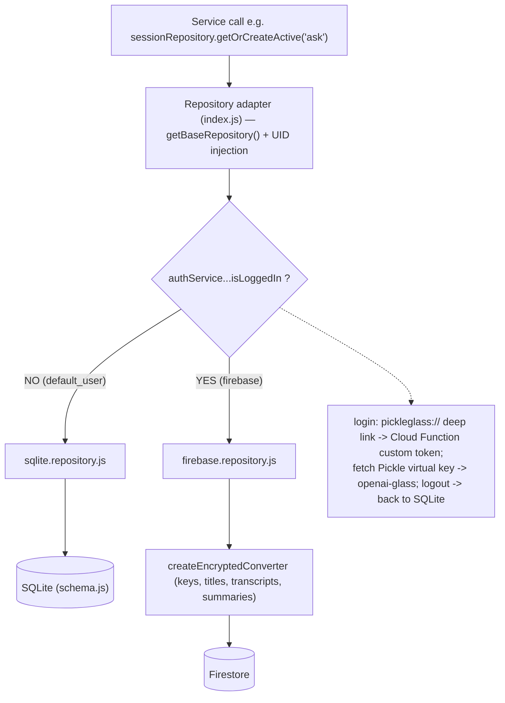

- **Dual repository pattern**: each user-data domain (`session`, `ask`, `stt`, `summary`,
  `user`, `preset`, `providerSettings`, …) has a `sqlite.repository.js` and a
  `firebase.repository.js` behind an `index.js` **adapter** (`repositories/session/index.js`).
  The adapter checks `authService.getCurrentUser().isLoggedIn` per call (`:10-21`) to pick the
  store, and injects the `uid` so services never handle user IDs.
- **Auth/storage switch**: `authService` starts as `default_user` in `'local'` mode
  (`authService.js:40-41`). `onAuthStateChanged` (`:51-126`) flips to `'firebase'` on login,
  fetches a **Pickle virtual key** by email and wires it as the `openai-glass` provider via
  `modelStateService.setFirebaseVirtualKey`, and reverts to local on logout. Sign-in itself is a
  `pickleglass://` deep link → Cloud Function (`pickleGlassAuthCallback`) → custom token
  (`index.js:498-562`).
- **Encryption**: when persisting to Firebase, API keys, titles, transcripts, and summaries are
  encrypted via a Firestore converter (`encryptionService` + `firestoreConverter.js`); see
  `docs/DESIGN_PATTERNS.md` principle #6.
- **Schema** (`schema.js`, single source of truth) — the tables that matter:

```
sessions          (id, uid, title, session_type, started_at, ended_at, sync_state, updated_at)
transcripts       (id, session_id, start_at, end_at, speaker, text, lang, ...)   -- Listen STT
ai_messages       (id, session_id, sent_at, role, content, tokens, model, ...)   -- Ask Q&A
summaries         (session_id PRIMARY KEY, text, tldr, bullet_json, action_json, model, ...)
provider_settings (provider PK, api_key, selected_llm_model, selected_stt_model, is_active_*)
model_catalog     ((provider, model_id) PK, listed, vision, max_output, reasoning, effort_levels,
                   thinking, server_fallback, override_*, key_output_limit, key_limit_at, fetched_at)  -- §9.1
prompt_presets · shortcuts · ollama_models · whisper_models · users · permissions
```

---

## 12. Local AI (Ollama + Whisper)

Glass can run fully local — no cloud, no API key:

- **Ollama** (local LLM) is managed by `ollamaService` + `localAIManager`. Models are tracked
  in the `ollama_models` table; the selected model is warmed up in the background at startup
  (`index.js:209-216`) and on selection (`modelStateService.js:461-463`). Ollama's `llmModels`
  list in the registry is empty and **populated dynamically** from installed models
  (`factory.js:86`, `modelStateService.getAvailableModels` `:481-483`).
- **Whisper** (local STT) runs **only in the main process** — the factory returns a stub in the
  renderer (`factory.js:91-102`). Models (tiny/base/small/medium) are downloaded with SHA-256
  verification from the manifest in `checksums.js`. STT output is filtered for noise tokens like
  `[BLANK_AUDIO]` (`sttService.js:204-230`).
- `localAIManager` periodically syncs service health and, if a local service goes down,
  `modelStateService` auto-reselects another available model
  (`handleLocalAIStateChange`, `:104-123`).

---

## 13. Prompts & Ask modes

Prompt text lives in `promptTemplates.js` (`profilePrompts`) and is assembled by
`promptBuilder.getSystemPrompt(profile, history, …)`. Ask has **four modes**, chosen from the
`mode-picker` window and stored in settings (`featureBridge.js:83` `VALID_ASK_MODES`):

| Ask mode | Prompt profile | Purpose |
|---|---|---|
| `default` | `pickle_glass_analysis` | General live co-pilot — answer the question / define the term / solve what's on screen |
| `code` | `pickle_glass_code` | Coding-interview solution: code + reasoning + time/space complexity (honors preferred language) |
| `debug` | `pickle_glass_debug` | Debug the code in the screenshot: issues, fixes, optimizations |
| `system_design` | `pickle_glass_system_design` | Staff-level system-design co-pilot: 12-section phased design with numbers |

The Listen summary uses the `pickle_glass_analysis` profile with a `{{CONVERSATION_HISTORY}}`
token. The `default` analysis profile encodes a strict decision hierarchy (answer recent
question → define proper noun → solve on-screen problem → passive acknowledgment) so the model
behaves predictably on noisy meeting transcripts (`promptTemplates.js:238-403`).

Live Answer passes career context through the same profile's `customPrompt` slot ("User-provided
context") when the interviewer asks about the candidate and `CAREER_KB_PATH` is set. Otherwise
the slot stays empty, as for Live Insights. When such an answer finishes, numbers and known names it
states that the notes lack are flagged under it. See
[`docs/LIVE_INSIGHTS_AND_ASK.md`](docs/LIVE_INSIGHTS_AND_ASK.md) §4.7, which also shows how the
intent router picks a route ([`docs/diagrams/14-career-intent-router.mmd`](docs/diagrams/14-career-intent-router.mmd)).
With `TYPESAFE_API_KEY` set, the route comes from Jev (TypeSafe AI, one network call per turn,
started inside the answer debounce); the regex router is the frozen fallback for timeouts,
errors and low confidence (`specs/2026-10-13-career-router-jev/`).

> Note: `ask:sendQuestionFromSummary` (the Listen "suggested action" buttons) only works in
> `default` mode and is rejected in the other modes (`featureBridge.js:160-169`).

---

## 14. Build, packaging & platform support

- **Renderer build**: `build.js` (esbuild) bundles the Lit views; `npm run build:renderer`.
- **Web build**: `npm run build:web` builds the Next.js dashboard into `pickleglass_web/out`,
  copied into app resources (`electron-builder.yml` `extraResources`).
- **Packaging** is `electron-builder` (`electron-builder.yml`):
  - **macOS** → `dmg` + `zip`, **universal** (Intel + Apple Silicon), hardened runtime,
    `entitlements.plist`, min macOS 11.
  - **Windows** → `nsis` installer + `portable`, **x64**, code-signed.
  - **Linux** → **no target defined** (you run it from source).
  - The macOS `SystemAudioDump` binary, `sharp` and `onnxruntime-node` are `asarUnpack`'d
    (`electron-builder.yml` `asarUnpack`) so they can execute from outside the asar archive.
  - `onnxruntime-node` (career-context embeddings) ships only the target platform's binaries, and
    `onnxruntime-web` is excluded (`files` patterns); Intel Macs have no binary and use keyword
    retrieval only.
- **Deep linking**: registers the `pickleglass://` protocol for the auth callback.
- **Auto-update**: `electron-updater` checks GitHub releases in production (`index.js:697-728`).

The `SystemAudioDump` binary (~179 KB) is committed under `src/ui/assets/` and is a macOS Mach-O
executable — it is never spawned on Windows/Linux (`sttService.js:680`).

---

## 15. "If I run it as-is"

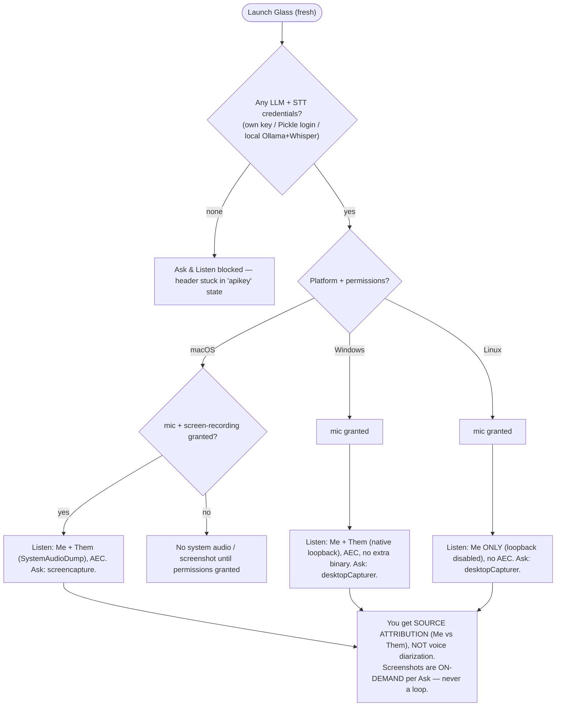

So, concretely, on first launch:

1. **You must provide credentials first.** Easiest "free" path is signing in with Pickle
   (hosted OpenAI key via Portkey); the offline path is installing Ollama + downloading a
   Whisper model. With your own keys, paste them in Settings.
2. **Grant OS permissions** (microphone everywhere; on macOS also screen recording for system
   audio + screenshots; macOS also prompts for Keychain to store the encryption key).
3. **Then** Ask works on all three platforms, and Listen gives you the two-channel `"Me"`/`"Them"`
   split on macOS and Windows (one channel on Linux). What you will **not** get on any platform
   is voice-based diarization — the split is purely by audio source.

---

## 16. Known limitations & gotchas

- **Listen → Ask context is not wired.** `listenService.getConversationHistory()` exists
  (`listenService.js:281`) but no path passes the live transcript into `askService.sendMessage`.
  Pressing Ask during a meeting sends only your text + the current screenshot, not the
  conversation. Wiring it is a small change in `featureBridge.js`.
- **Ask is stateless across presses** (§6) — by current wiring, not a model limitation.
- **No STT failover / no reconnect-on-drop** (§7.3, §10) — a dropped live STT socket is logged,
  not recovered; the only resilience is the timed 20-min renewal and OpenAI keep-alive.
- **Diarization is source attribution** (§0/§7.2) — two people on one mic are both `"Me"`.
- **Linux has no system audio and no prebuilt binary** — mic-only, run from source.
- **Deepgram STT is pinned to `nova-3`** regardless of registry entries
  (see `docs/AUDIO_AND_STT.md §4`).
- **Vestigial `screenshotInterval`** in settings/`startCapture` is unused — there is no periodic
  screenshot loop.
- **`captureManualScreenshot`** (the `Ctrl/Cmd+Shift+S` keybind, `shortcutsService.js:253-258`)
  calls `window.captureManualScreenshot`, which is not actually exported by `listenCapture.js`
  — effectively a dead path today.

---

## 17. File map — where to look

| Area | Start here |
|---|---|
| App entry / lifecycle / web stack / deep links | `src/index.js` |
| Windows, invisibility, layout | `src/window/windowManager.js`, `windowLayoutManager.js`, `smoothMovementManager.js` |
| IPC | `src/preload.js`, `src/bridge/{featureBridge,windowBridge,internalBridge}.js` |
| Ask (vision) | `src/features/ask/askService.js`, `src/ui/ask/AskView.js` |
| Listen (audio/STT) | `src/features/listen/listenService.js`, `stt/sttService.js`, `src/ui/listen/audioCore/listenCapture.js` |
| Summarization | `src/features/listen/summary/summaryService.js` |
| Live panels setting (which Listen lanes run) | `src/features/listen/liveFeatures.js`, `src/ui/settings/SettingsView.js`, `src/ui/listen/ListenView.js` |
| Live Answer career context | `src/features/common/career/` (entry `index.js`), `scripts/eval-career-kb.js`, `scripts/ask-career-kb.js` |
| AI providers / factory | `src/features/common/ai/factory.js`, `ai/providers/*.js` |
| Gemini failover | `ai/providers/gemini.js`, `ai/providers/geminiModelRotator.js`, `ai/providers/modelHealth.js` |
| Anthropic failover | `ai/providers/anthropic.js`, `ai/providers/anthropicErrors.js`, `ai/providers/modelHealth.js` |
| Groq failover | `ai/providers/groq.js`, `ai/providers/groqErrors.js`, `ai/providers/modelHealth.js` |
| Cross-provider lists | `ai/factory.js` (`splitByProvider`), `ai/providerChain.js`, `ai/providers/modelHealth.js` (`isCoolingDown`) |
| Model & key state | `src/features/common/services/modelStateService.js` |
| Auth / encryption | `src/features/common/services/{authService,encryptionService,migrationService}.js` |
| Persistence | `src/features/common/repositories/**`, `src/features/common/config/schema.js` |
| Local AI | `src/features/common/services/{ollamaService,whisperService,localAIManager}.js` |
| Prompts / Ask modes | `src/features/common/prompts/{promptBuilder,promptTemplates}.js` |
| Web dashboard | `pickleglass_web/` |
| Packaging | `electron-builder.yml`, `build.js`, `entitlements.plist` |

---

*Generated by reverse-engineering the source at the current commit. Diagram sources:
[`docs/diagrams/`](docs/diagrams/). If you change a subsystem, update the matching section and
`.mmd` file together.*
