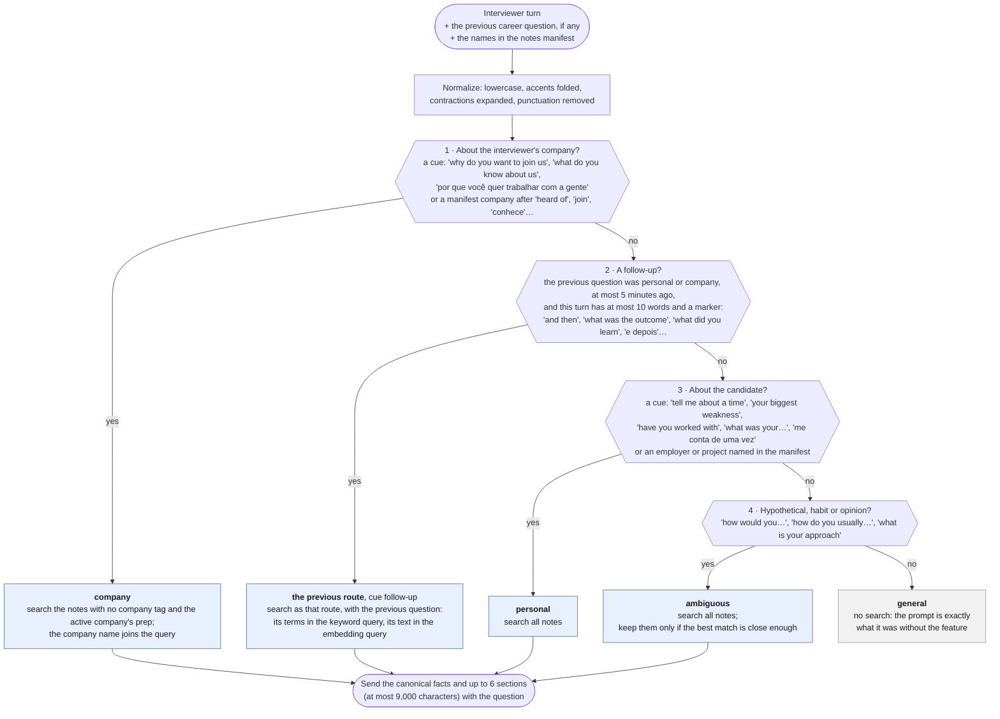
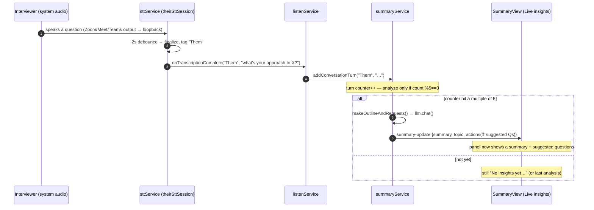

# Live Insights & Answer Generation

How Glass turns a live conversation into **Live Insights** (the panel that starts out saying
*"No insights yet…"*) and how it generates **answers** on demand. This picks up where
[`AUDIO_AND_STT.md`](AUDIO_AND_STT.md) ends (a finalized transcript turn) and complements the
architecture-level summaries in [`../ARCHITECTURE.md`](../ARCHITECTURE.md) §6 (Ask) and §8
(summarization). All claims carry `file:line` references to the current code.

---

## 1. The mental model: two assistants, not one

Glass helps a live conversation in **two independent ways**. Keeping them straight is the key
to understanding the interview scenario in §5.

| | **Live Insights** (Listen) | **Live Answer** (Listen) | **Ask** |
|---|---|---|---|
| Trigger | Automatic, while listening | Automatic — on `them:` question detected | On-demand (hotkey / typing / clicking a suggestion) |
| Sees the audio transcript? | **Yes** — built *from* the transcript | **Yes** — uses same conversation history | **No** — transcript is never passed (§5) |
| Sees the screen? | No | No | **Yes** — one fresh screenshot per press |
| Cadence | Every **5th** finalized turn | On each detected `them:` question, 800 ms debounce | Once per request |
| LLM call | `llm.chat()` (non-streaming) | `streamChat()` (streaming, two-arg `createStreamingLLM`) | `streamChat()` (streaming) |
| Output | Structured panel: Summary / Topic / Actions | Streamed markdown answer rendered above Live Insights | Free-form streamed markdown answer |
| PASSIVE suppression | No | Yes — stream prefix checked; if `PASSIVE`, holds last answer | No |
| Engine | `summaryService.js` (analysis lane) | `summaryService.js` (answer lane — additive, independent) | `askService.js` |
| UI | `SummaryView` (the "Live insights" tab) | `LiveAnswerView` (above `<summary-view>` in insights pane) | `AskView` (separate window) |
| Safety | n/a | Answer rendered ONLY in the content-protected listen window; never logged | n/a |

> **The one-sentence version:** *Live Insights summarizes; Live Answer directly answers. Both
> "hear" the room. Ask answers what you type or what's on your screen.* The answer lane and the
> insights lane share the conversation history but no mutable state — deleting either leaves the
> other unchanged (FR-017).

---

## 2. From transcript to insights — the handoff

Each finalized utterance (after the 2 s completion debounce — see
[`AUDIO_AND_STT.md` §1](AUDIO_AND_STT.md)) fires the STT callback, which `listenService`
forwards two places at once (`listenService.js:99-107`):

```
sttService  ──onTranscriptionComplete(speaker, text)──►  listenService.handleTranscriptionComplete
                                                              │
                                       ┌──────────────────────┴───────────────────────┐
                                       ▼                                               ▼
                          sttRepository.addTranscript()                 summaryService.addConversationTurn()
                          (persist to `transcripts` table)              (feed the Live Insights engine)
                          listenService.js:118                          listenService.js:106
```

So **every** `"Me"`/`"Them"` turn that lands in the transcript is also pushed into the insights
engine as a string `"me: …"` / `"them: …"` (`summaryService.js:666-676`).

---

## 3. Live Insights — the "No insights yet…" panel

### 3.1 What the panel is

The Listen window opens on the **"Live insights"** view by default (`ListenView.js:436`,
label at `:632`), with a toggle button to **"Show Transcript"** / **"Show Insights"**
(`ListenView.js:546-549`, `:642-658`). The insights view is the `SummaryView` Lit component
(`src/ui/listen/summary/SummaryView.js`); the transcript view is `SttView`.

### 3.2 Why it says "No insights yet…"

`SummaryView` shows that placeholder whenever it has **no structured content to render**
(`SummaryView.js:466-471`):

```js
const hasAnyContent = data.summary.length > 0
                   || data.topic.bullets.length > 0
                   || data.actions.length > 0;
// …
${!hasAnyContent
    ? html`<div class="empty-state">No insights yet...</div>`
    : html` … render Summary / Topic / Actions / Follow-Ups … `}
```

The component starts with empty arrays (`SummaryView.js:244-249`) and is reset to empty at the
start of every new Listen session (`resetAnalysis()`, `:281-289`, called from
`ListenView.js:469`). So **"No insights yet…" is the normal state at the start of every
session** — it is not an error.

### 3.3 When it gets filled — the every-5-turns rule

Insights are produced by `summaryService.triggerAnalysisIfNeeded()`, which runs after **every**
conversation turn but only *fires an analysis* on multiples of 5 (`summaryService.js:963-964`):

```js
if (this.conversationHistory.length >= 5 && this.conversationHistory.length % 5 === 0) {
    const data = await this.makeOutlineAndRequests(this.conversationHistory);
    // …
    this.sendToRenderer('summary-update', data);   // → SummaryView updates
}
```

A "turn" is **one finalized utterance from either speaker** (mic *or* system audio, combined
into one running list). So:

| Finalized turns so far | What the panel shows |
|---|---|
| 0 – 4 | **"No insights yet…"** (engine is silent — below threshold) |
| **5** | First analysis appears (Summary / Topic / Actions) |
| 6 – 9 | Unchanged — still showing the turn-5 analysis |
| **10** | Refreshes, building on the previous analysis |
| 15, 20, 25 … | Refreshes again at each multiple of 5 |

**Practical consequence:** the panel stays on *"No insights yet…"* until the **5th finalized
utterance** of the session, then updates only once per 5 additional turns. A short exchange
(e.g. one question + one answer = 2 turns) may never cross the threshold. There is **no
manual "analyze now"** button — the cadence is purely turn-count driven.

> Throughput note: turns only count once STT finalizes them (after the 2 s debounce). Rapid
> back-and-forth fills the counter faster; long monologues count as a single turn until the
> speaker pauses.

### 3.4 What populates each section

`makeOutlineAndRequests()` (`summaryService.js:728-845`) builds the prompt and calls the LLM:

1. **Prompt** = the `pickle_glass_analysis` system profile with its `{{CONVERSATION_HISTORY}}`
   token replaced by the **last 30 turns** (`summaryService.js:751-752`,
   `formatConversationForPrompt`, `:723-726`), plus the **previous analysis** folded back in for
   continuity (`:739-749`), plus a hardcoded user message that requests this exact shape
   (`:772-792`):

   ```
   **Summary Overview**      → parsed into  data.summary[]    (≤5 bullets)
   **Key Topic: <name>**     → parsed into  data.topic.header + data.topic.bullets[] (≤3)
   **Extended Explanation**  → appended to  data.topic.bullets[]
   **Suggested Questions**   → parsed into  data.actions[] as "❓ <question>"
   ```

2. **LLM call** is **non-streaming** — `createLLM(provider).chat(messages)`
   (`summaryService.js:798-807`) — unlike Ask, which streams.

3. **Parse** — `parseResponseText()` (`:847-958`) turns the markdown into
   `{ summary, topic{header,bullets}, actions, followUps }` and always appends the default
   actions `"✨ What should I say next?"` and `"💬 Suggest follow-up questions"` (`:926-927`).

4. **Render + persist** — `sendToRenderer('summary-update', data)` (`:970`) updates the panel
   (`SummaryView.connectedCallback` → `onSummaryUpdate`, `:266-270`); the row is also UPSERTed
   into the `summaries` table (`:813-826`).

The rendered sections (`SummaryView.render`, `:455-547`):

| Panel section | Source field | Notes |
|---|---|---|
| **Current Summary** | `data.summary` | up to 5 bullets |
| **Key Topic: …** | `data.topic` | header + up to 3 bullets |
| **Actions** | `data.actions` | suggested questions + the two default prompts |
| **Follow-Ups** | `data.followUps` | only shown **after** the session ends (`hasCompletedRecording`, `ListenView.js:474`, `SummaryView.js:528`) |

### 3.5 Insights are clickable → they forward into Ask

Every summary / topic / action line is clickable. Clicking one calls
`handleRequestClick()` → `window.api.summaryView.sendQuestionFromSummary(text)`
(`SummaryView.js:406-425`, `preload.js:207`), which routes to
`ask:sendQuestionFromSummary` → `askService.sendMessage(text)` (`featureBridge.js:135-144`).
**This is the only built-in bridge from the transcript world into Ask** — and even then, only
the **clicked text** crosses over (see §4). It is **rejected unless Ask is in `default` mode**
(`featureBridge.js:136-142`); the error is surfaced to the user (`SummaryView.js:413-419`).

---

## 4. Live Answer lane — automatic streaming answers for `them:` questions

The Live Answer lane is an additive feature that runs **beside** the Live Insights engine in
`summaryService.js`. Both read from the same `conversationHistory` but share no mutable state —
deleting either leaves the other unchanged.

### 4.1 How it triggers

After every `addConversationTurn(speaker, text)` call, `triggerAnswerIfNeeded` runs beside
`triggerAnalysisIfNeeded`. Four gates decide whether an answer stream starts:

1. **Speaker gate** — `speaker.toLowerCase() !== 'them'` → skip. Only the interviewer's turns trigger answers (FR-001).
2. **Question heuristic** — `isLikelyQuestion(text)` (FR-002). A turn counts as a question when any of these holds:
   - a `?` appears anywhere;
   - an interview cue appears (`tell me`, `walk me through`, `describe`, `design`, `compare`, `difference between`, `trade-offs`, …);
   - an embedded question appears ("the question is what…", "I'm curious how…");
   - a wh-word or yes/no auxiliary leads any clause, after peeling discourse markers ("okay so how does X work").

   Declarative monologue is skipped to save quota. When the career module is ready, a turn with a career cue also passes ("your biggest weakness", §4.7); while it is off, the gate is exactly the one above.
3. **800 ms debounce** — multi-segment utterances (STT delivers words in fragments) coalesce into one trigger (FR-003).
4. **De-dup + abort-or-suppress** in the debounce callback:
   - Same normalized tail as `lastAnsweredTail` → skip (FR-004b).
   - New tail while a stream is already in-flight → abort old stream, start new (FR-004a).
   - Same question as in-flight → skip.

### 4.2 PASSIVE suppression (streaming-aware prefix buffer)

The model is prompted to reply `PASSIVE` when the question has no clear technical answer. Because
the response arrives as a stream, the service buffers the prefix until the first `\n` or ~16 chars,
then calls `parseAnswerOrPassive(prefix)`:

- If the normalized prefix matches `"PASSIVE"` (any markdown wrapping) or the native phrase
  `"Not sure what you need help with right now"` → suppress. No IPC emit; the panel holds the
  last rendered answer unchanged (never blanks — Q1/G3/FR-010).
- Otherwise → flush the buffered prefix as the first emit and stream subsequent deltas live.

### 4.3 IPC channel: `live-answer-update`

`summaryService.sendToRenderer('live-answer-update', { id, question, answer, ts })` is emitted on
every non-suppressed delta. The payload accumulates the full markdown string up to that point; the
renderer replaces its `innerHTML` on each event (single swap per frame — C5/FR-015). When career
context was injected (§4.7), every answer payload of that `id` also carries `sources` (note titles),
shown as a muted "from: …" line.

The same channel also carries **status payloads** (no `answer` text), so the panel can say what is
happening when there is no answer to show:

| Payload | Sent when | Panel |
|---|---|---|
| `{ id, question, status: 'retrying', model }` | each Gemini `_reset` (failover, timeout, retry round); `model` is its `next_model` | "Trying <model>…" |
| `{ id, status: 'idle' }` | that answer's stream ends after a `retrying` | clears its "Trying …" (same `id` only) |
| `{ id, question, status: 'error', error }` | the stream fails (`error` = the provider's `userMessage`, e.g. `All Gemini models failed …`) or ends with no text | "No answer — <error>" until an answer starts |

Aborted answers (a newer question, session reset) send no error. `liveAnswerHistory.js` keeps
the two concerns apart: `applyLiveAnswerUpdate` ignores payloads without `answer`, and
`applyLiveAnswerStatus` folds the status payloads into one line under the "Live Answer" eyebrow,
rendered as a Lit text binding (never `innerHTML`).

The channel is wired in `preload.js` via two new methods on the existing `summaryView` namespace
(FR-013):

```js
// src/preload.js — summaryView namespace additions
onLiveAnswerUpdate: (callback) => ipcRenderer.on('live-answer-update', callback),
removeAllLiveAnswerUpdateListeners: () => ipcRenderer.removeAllListeners('live-answer-update'),
```

`LiveAnswerView.js` subscribes in `connectedCallback` and tears down in `disconnectedCallback`.

### 4.4 Screen-share safety invariant (load-bearing)

The answer renders **only** in the content-protected `listen` window (`windowManager.js:507`,
`settingsService.js:217` default `contentProtection: true`). The implementation never calls
`setContentProtection(false)` and never logs the answer text to any capturable sink. Verified
by T-VERIFY-SAFETY.

### 4.5 Session reset

`resetLiveAnswer()` is folded into `resetConversationHistory()` (C4/D4 — `listenService.js`
already calls `resetConversationHistory` at session start and close; no `listenService.js` edit
needed). It clears the debounce timer, aborts any in-flight `AbortController`, and resets
`lastAnsweredTail`, `inFlight`, `hadFallback`, and the career session state (`careerPrev`,
`activeCompany`, §4.7).

### 4.6 Gemini failover and debugging

With Gemini, `createStreamingLLM` (`src/features/common/ai/providers/gemini.js`) keeps one
answer alive across model failures:

- **Failover.** On a transient error (429, 503, …) or when no chunk arrives within the first-chunk
  timeout (25 s for Flash-Lite models, 60 s for others; `GEMINI_FIRST_CHUNK_TIMEOUT_MS` overrides),
  it emits a `_reset` sentinel and tries the next model. The panel shows "Trying <model>…" (§4.3).
- **Hedge.** A Flash-Lite request that has sent nothing after 10 s gets a second, parallel request
  to the same model; the first to stream wins (`GEMINI_HEDGE_DELAY_MS` overrides, `0` disables).
- **Second round.** Models that failed fast with a transient error get one more round after a short wait.
- **Deadline.** The request gives up when no answer has started within 60 s across every attempt.
  Once an answer is streaming, it is never cut.

When to expect 503s: [`GEMINI_503_PEAK_HOURS.md`](GEMINI_503_PEAK_HOURS.md).

`LIVE_ANSWER_DEBUG=1` (env or `.env`) logs the lane's decisions: the trigger gate, the
provider/model in use, the PASSIVE decision and the streamed character count. It never logs answer
text. The career module adds its `[career]` lines under the same flag (§4.7).

### 4.7 Career context (personal answers from your notes)

When the interviewer asks about the candidate's own background, Live Answer can answer in first
person from a local folder of career notes. Code: `src/features/common/career/` (only `index.js`
is used from outside). Spec: `specs/2026-10-11-live-answer-career-context/`.

**Enable.** In `.env`:

| Variable | Meaning |
|---|---|
| `CAREER_KB_PATH` | Folder of markdown/text notes. Unset or missing → the feature is off and Live Answer behaves exactly as before |
| `CAREER_KB_COMPANY` | Optional. The interviewing company, as the manifest aliases spell it (or a folder name without aliases). Otherwise the first company named by the interviewer in a company-context phrase ("here at X", "aqui na X", "conhece a X") is used |
| `CAREER_KB_VECTORS` | Optional. `off` keeps retrieval keyword-only (BM25) and never starts the embedding model, saving ~0.7 GB of RAM |

**Manifest.** An optional `glass-kb.json` at the notes root:

```json
{
  "version": 1,
  "core": ["about-me/canonical-facts.md"],
  "entities": ["Example Corp", "Example Project"],
  "include": ["**/*.md", "**/*.txt"],
  "exclude": ["chats/**", "drafts/**"],
  "companies": { "root": "interviews", "skip": ["shared"], "aliases": { "acme": ["Acme", "Acme Labs"] } }
}
```

- `core`: the canonical-facts card. It is injected whole whenever context is injected, wins over
  other notes, and is never chunked.
- `entities`: employer and project names. The router treats them as personal cues.
- `include`/`exclude`: globs (`*`, `**`, `?`). Exclude wins; `.git` and `node_modules` are always
  excluded.
- `companies`: each folder under `root` is one company's prep. Its chunks are tagged with the
  folder's aliases (narrowed by file name) or the folder name. `skip` lists shared folders.

Without a manifest, every `.md`/`.txt` is indexed. Lines with `[PREENCHER` or `⚠️ CONFIRMAR` are
never injected.

**Per question** (the debounce callback, after the `AbortController` exists):

1. **Route.** A deterministic, provider-agnostic router (`intentRouter.js`, English and
   Portuguese cue tables) picks one of four routes:
   - `personal`: behavioral, background, experience, employer names;
   - `company`: "why us", "what do you know about us";
   - `ambiguous`: "how would you…", "how do you usually…";
   - `general`: everything else.

   A short follow-up ("and what was the outcome?") within 5 minutes stays on the previous route.
2. **Retrieve.** The query is the turn minus framing phrases, with the extracted question boosted,
   the previous question's terms merged on follow-ups, and the company name added on the company
   route. A follow-up's embedding query is the previous question followed by the follow-up, so
   "and what was the outcome?" still finds the story. Retrieval merges three rankings by reciprocal rank fusion: BM25 over chunk titles
   (weight 3) and bodies, and multilingual embeddings (Arctic Embed v2.0, worker process) of the
   question against each chunk's text and against its section title. At most one section per
   note file is kept.
   - The company route drops other companies' chunks.
   - The ambiguous route injects only above a threshold.
3. **Inject.** The card plus up to six chunks, capped at 9,000 characters, go into the prompt's
   existing *User-provided context* slot (`getSystemPrompt`'s `customPrompt`). A first-person
   addendum is appended to the user message. On the `general` route, or when nothing is found,
   the prompt is byte-identical to the pre-feature one.
4. **Show.** The note titles ride on that answer's `live-answer-update` payloads as `sources`.
   `LiveAnswerView` shows them as a muted "from: …" line under the question.
5. **Check.** When the answer finishes, every number in it (compared by value, so `1,000`, `1.000`
   and `1k` match) and every employer, project or company name from the manifest that appears
   nowhere in what the model was given (the notes, the question, the transcript) is listed under
   the answer: "⚠ not in your notes: …". It asks you to check before saying it; it is not proof of
   an error, since a number worked out from the notes (years since a start date) is flagged too.
   Numbers written as words and names outside the manifest are not checked.

**How the router picks a route.** `classifyCareerIntent` (`intentRouter.js`) runs four checks in
a fixed order, and the first match wins. It calls no model and reads no files, so it takes well
under a millisecond. Diagram source: [`diagrams/14-career-intent-router.mmd`](diagrams/14-career-intent-router.mmd).



- **Cues.** Each check is a table of `[name, regex]` pairs, in English and Portuguese, matched
  against the normalized text ("What's" becomes "what is", "você" becomes "voce"). The rule name
  is the `cue=` of the debug line; the text itself is never logged.
- **Order.** The first match wins, so the order settles mixed questions:
  - company before everything: "Tell me about a time you led a project, and why do you want to
    join us?" is company;
  - follow-up before personal: "What did you learn?" right after a company question stays
    company, while on its own it is personal ("did you");
  - personal before ambiguous.
- **Follow-ups.** All four conditions must hold. The previous question is the last answer that
  used the personal or company route; any other answer clears it, and so does a new session.
- **Manifest names.** An `entities` name (employer, project) anywhere in the turn makes it
  personal. A `companies` name makes it company only after a phrase such as "heard of", "know
  about", "join", "conhece" or "trabalhar na".
- **Close enough** (ambiguous route): the best section's cosine is at least the model's threshold
  (0.35 for Arctic Embed); when the answer is keyword-only, at least half the query terms, and
  two or more, appear in it.
- **The answer gate.** Live Answer answers turns that look like questions. While the notes are
  loaded, a turn the router calls personal or company on its own (without the previous question)
  is answered too, so a statement such as "Your biggest weakness." gets an answer.

| Interviewer says | Route | Cue |
|---|---|---|
| "Why do you want to join us?" | company | `company:why-join` |
| "Have you heard of Acme before?" (Acme is a manifest company) | company | `company:named` |
| "Tell me about a time you disagreed with a teammate" | personal | `behavioral:tell-me-about-a-time` |
| "Me conta de uma vez que você discordou de um colega" | personal | `behavioral:pt-uma-vez` |
| "What was your biggest project?" | personal | `background:your-trait` |
| "Have you worked with Kafka?" | personal | `experience:have-you` |
| "How big was the team at Example Corp?" (a manifest entity) | personal | `entity` |
| "How would you design a rate limiter?" | ambiguous | `hypothetical:how-would-you` |
| "How do you usually handle conflict?" | ambiguous | `habitual:how-do-you` |
| "What is a B-tree?" | general | none |
| "And what was the outcome?", 1 minute after a personal answer | personal | `follow-up` |
| "And what was the outcome?", with no previous question or 6 minutes later | general | none |

**Change it.** Add a `[name, regex]` pair to the right table in `intentRouter.js`, written for the
normalized text, and a case to `__tests__/intentRouter.test.js`. `node scripts/ask-career-kb.js
"question"` prints the route and cue of one question; the eval reports router accuracy over its
questions.

**Lifecycle.** The index warms at app start and refreshes changed files (mtime) at every Listen
session start, never on the answer path. The query embedding is prefetched when a gated turn
arrives, so at debounce-fire it waits at most 150 ms; otherwise that answer is BM25-only. The
embedding model is downloaded once (~310 MB) into `userData/career-kb/models`. Text and title
vectors are cached in `userData/career-kb/vectors-*.bin`, keyed by content hash and model id. The
first full pass is CPU work in the background (about 25 minutes for a few thousand chunks);
answers use BM25 until it finishes. Later launches load the cached vectors and embed only new or
edited sections; the model still loads at each launch, to embed the questions.

Any failure degrades to BM25 or to today's behavior (no context):
- folder missing;
- invalid manifest;
- model offline;
- worker crash.

**Debug line** (`LIVE_ANSWER_DEBUG=1`), ids and timings only, never note or turn text:

```
[career] route=personal cue=behavioral:tell-me-about-a-time chunks=a1b2c3d4e5f6,… scores=0.0325,… top=cos:0.871/cov:0.67 bm25=0.4ms vector=used(0.1ms wait) total=3.2ms
```

After an answer that used notes, `[career] check unverified=N` gives the count of flagged items (never the items).

**Quality check.** `node scripts/eval-career-kb.js [--bm25-only] [--json]` reads
`<KB>/glass-eval/questions.jsonl` and reports:
- router accuracy;
- recall;
- company leaks;
- latency.

Each item's own source note is left out.

**Try one question.** `node scripts/ask-career-kb.js "question"` prints the route, the ranked
sections with their place in each ranking (keywords, note text, section title), and what would
be sent; `--block` prints the exact text. Without a question it reads one per line, so
follow-ups work as in the app. Its output shows note titles and text: keep it out of this repo.

Both scripts read `CAREER_KB_PATH` from `.env` and use the app's vector cache
(`userData/career-kb`), so they embed nothing the app already has.

**Rollback.** Unset `CAREER_KB_PATH`.

---

## 5. Ask — and why it does not hear the interviewer

The full Ask mechanics live in [`../ARCHITECTURE.md` §6](../ARCHITECTURE.md). The one fact that
matters most for the interview scenario:

> **Ask never receives the live transcript.** `askService.sendMessage(userPrompt,
> conversationHistoryRaw=[])` (`askService.js:219`) *can* accept conversation history and would
> format the last 30 turns (`_formatConversationForPrompt`, `:207-212`) — but **every** caller
> passes only the prompt: `ask:sendQuestionFromAsk` and `ask:sendQuestionFromSummary` both call
> `askService.sendMessage(userPrompt)` with no second argument (`featureBridge.js:134`, `:143`),
> and the screenshot-only path passes `[]` explicitly (`askService.js:154`).

So when you press Ask, the model receives exactly: **the system prompt + your typed text + one
fresh screenshot** (`askService.js:291-306`). It does **not** see what the interviewer just
said unless that text is on the screen or you typed/pasted it yourself. This is wiring, not a
model limitation — see [`../ARCHITECTURE.md` §16](../ARCHITECTURE.md) ("Listen → Ask context is
not wired").

**Two ways to actually submit an Ask:**

| Path | How | What's sent |
|---|---|---|
| Typed question | Type in the Ask box, press Enter (`AskView.js:1287-1299`, `:1301-1314`) | your text + screenshot |
| Screenshot-only | `Ctrl/Cmd+Enter` (`nextStep`) while the Ask box is open → `toggleAskButton(true)` → `sendMessage('', [])` (`shortcutsService.js:213-214`, `askService.js:148-156`) | empty text + screenshot only |

The screenshot-only path leans on the `pickle_glass_analysis` decision hierarchy: with no
typed question, the model falls through to **"solve the clear problem visible on screen"**
(`promptTemplates.js:362-372`) — ideal for a coding/LeetCode/system-design prompt that's on
screen.

---

## 6. Scenario: the interviewer asks a question — how do I get an answer?

Because Ask is transcript-blind (§5), there is no single "the interviewer spoke → Glass
auto-answers in Ask" path. Here is what actually happens and the proper flows to get an answer.

### 6.1 What happens automatically



So the interviewer's question lands in the **transcript** immediately, but it only influences
the **Live Insights** panel, and only when the turn count next hits a multiple of 5. The
insights `pickle_glass_analysis` profile is explicitly built to *answer a question at the end
of the transcript* (`promptTemplates.js:247-275`), so the panel's Summary/Actions often already
contain the gist of an answer and suggested replies.

### 6.2 The proper flows to get a usable answer

Pick based on what kind of question it is:

1. **Read the Live Insights panel (passive).** For discussion/behavioral questions, the panel's
   *Current Summary* + *Actions* ("❓ …", "✨ What should I say next?") frequently give you
   enough to respond. Caveat: throttled to every-5-turns (§3.3), and it's a summary, not a
   verbatim answer.

2. **Click a suggested question/action in the panel (bridge into Ask).** Clicking forwards that
   text into Ask (§3.5) and you get a fuller, streamed answer in the Ask window. Requires Ask to
   be in **`default` mode**. Note the answer is generated from *that clicked text + a fresh
   screenshot* — not the surrounding conversation.

3. **Type or paste the question into Ask (active, most direct).** Open Ask, type the question
   (or paste it), press Enter. This is the most reliable way to get a direct answer to a
   *specific* spoken question, because you're handing the model the exact text. Choose the Ask
   **mode** to match: `default` for general, `code` for a coding problem, `debug` to fix code on
   screen, `system_design` for a design prompt (`featureBridge.js:82`,
   [`../ARCHITECTURE.md` §13](../ARCHITECTURE.md)).

4. **Screenshot-only Ask (when the question is on the screen).** If the interviewer's prompt is
   visible (shared coding problem, design canvas, slide), press `Ctrl/Cmd+Enter` with the Ask
   box open to send just the screenshot (§5); the model solves what it sees.

### 6.3 Recommended interview setup

- **Run Listen for the whole session** so the transcript + insights build continuously (this is
  the only component that captures the interviewer). On **Windows and macOS** you get the clean
  *"Me"* vs *"Them"* split; on **Linux** the interviewer (system audio) is **not** captured at
  all (loopback disabled — [`AUDIO_AND_STT.md` §2](AUDIO_AND_STT.md)).
- **For spoken Q&A:** glance at Live Insights for the gist; for a specific answer, **type the
  question into Ask** (flow 3) or **click the matching suggested question** (flow 2).
- **For a coding / system-design prompt on screen:** put Ask in `code` / `system_design` mode
  and use **screenshot-only Ask** (flow 4).
- Keep Ask in **`default` mode** if you want the panel's clickable suggestions to work
  (flow 2) — they're blocked in the other modes.

---

## 7. Implementation notes & quirks (verified)

- **Insights never auto-open Ask.** A `summary-update` only repaints the panel; it never
  launches an answer. Producing an answer always requires one of the §6.2 user actions.
- **Stray template token in Ask `default` mode.** The Ask path builds the prompt with
  `getSystemPrompt('pickle_glass_analysis', conversationHistory, false)` (`askService.js:288`),
  which places the (empty) history in the *"User-provided context"* slot but does **not** replace
  the profile's trailing `{{CONVERSATION_HISTORY}}` token (`promptTemplates.js:402`) — only the
  *summary* path calls `.replace('{{CONVERSATION_HISTORY}}', …)` (`summaryService.js:752`). So in
  `default` Ask mode the literal string `{{CONVERSATION_HISTORY}}` reaches the model. Cosmetic
  today (models ignore it); it would matter if/when Listen→Ask history is wired.
- **Insights are non-streaming; Ask streams.** The panel updates in one shot per analysis
  (`summaryService.js:807`); Ask renders token-by-token (`askService._processStream`,
  `:401-474`).
- **One summary row per session.** The `summaries` table is UPSERTed, not appended
  (`summaryService.js:813-826`) — the panel reflects the latest rolling analysis, not a history.
- **Follow-Ups appear only after Stop.** They're gated on `hasCompletedRecording`
  (`ListenView.js:473-477`, `SummaryView.js:528`), so they show up once the session ends, not
  mid-conversation.

---

## 8. File map

| Concern | File |
|---|---|
| STT → transcript handoff | `src/features/listen/listenService.js` (`:99-127`) |
| Live Insights + Live Answer engine | `src/features/listen/summary/summaryService.js` |
| Live Insights UI ("No insights yet…") | `src/ui/listen/summary/SummaryView.js` |
| Live Answer UI (streamed markdown, above `<summary-view>`) | `src/ui/listen/summary/LiveAnswerView.js` |
| Live Answer tests (pure helpers + integration) | `src/features/listen/summary/__tests__/liveAnswer.test.js`, `liveAnswerCareer.test.js` |
| Career context (router, retrieval, context block, embedder) | `src/features/common/career/` (entry point `index.js`) |
| Career context eval | `scripts/eval-career-kb.js` |
| Career retrieval for one question | `scripts/ask-career-kb.js` |
| Listen window / insights-vs-transcript toggle | `src/ui/listen/ListenView.js` |
| Ask answer engine | `src/features/ask/askService.js` |
| Ask UI | `src/ui/ask/AskView.js` |
| Prompt profiles | `src/features/common/prompts/promptTemplates.js`, `promptBuilder.js` |
| IPC wiring (incl. `live-answer-update` channel) | `src/bridge/featureBridge.js`, `src/preload.js` |
| Ask hotkey | `src/features/shortcuts/shortcutsService.js` (`:213-214`) |

---

*See also: [`AUDIO_AND_STT.md`](AUDIO_AND_STT.md) (capture → transcript),
[`../ARCHITECTURE.md`](../ARCHITECTURE.md) §6 (Ask), §8 (summarization), §13 (prompt profiles),
§16 (known limitations).*
