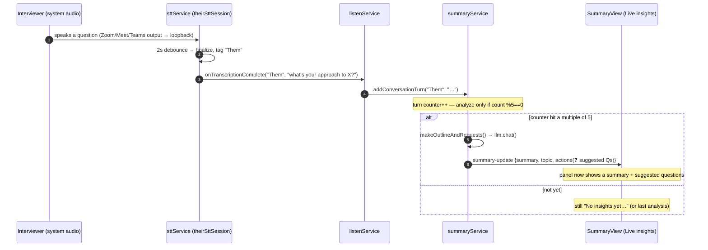

# Live Insights & Answer Generation

How Glass turns a live conversation into **Live Insights** (the panel that starts out saying
*"No insights yet…"*) and how it generates **answers** on demand. This picks up where
[`AUDIO_AND_STT.md`](AUDIO_AND_STT.md) ends (a finalized transcript turn) and complements the
architecture-level summaries in [`../ARCHITECTURE.md`](../ARCHITECTURE.md) §6 (Ask) and §8
(summarization). All claims carry `file:line` references to the current code.

---

## 1. The mental model: two assistants, not one

Glass helps a live conversation in **two independent ways**. Keeping them straight is the key
to understanding the interview scenario in §5.

| | **Live Insights** (Listen) | **Live Answer** (Listen) | **Ask** |
|---|---|---|---|
| Trigger | Automatic, while listening | Automatic — on `them:` question detected | On-demand (hotkey / typing / clicking a suggestion) |
| Sees the audio transcript? | **Yes** — built *from* the transcript | **Yes** — uses same conversation history | **No** — transcript is never passed (§5) |
| Sees the screen? | No | No | **Yes** — one fresh screenshot per press |
| Cadence | Every **5th** finalized turn | On each detected `them:` question, 800 ms debounce | Once per request |
| LLM call | `llm.chat()` (non-streaming) | `streamChat()` (streaming, two-arg `createStreamingLLM`) | `streamChat()` (streaming) |
| Output | Structured panel: Summary / Topic / Actions | Streamed markdown answer rendered above Live Insights | Free-form streamed markdown answer |
| PASSIVE suppression | No | Yes — stream prefix checked; if `PASSIVE`, holds last answer | No |
| Engine | `summaryService.js` (analysis lane) | `summaryService.js` (answer lane — additive, independent) | `askService.js` |
| UI | `SummaryView` (the "Live insights" tab) | `LiveAnswerView` (above `<summary-view>` in insights pane) | `AskView` (separate window) |
| Safety | n/a | Answer rendered ONLY in the content-protected listen window; never logged | n/a |
| Can be turned off | Yes — Settings → **Live panels: Answer only** (§3.6) | Yes — Settings → **Live panels: Insights only** (§4.8) | No |

> **The one-sentence version:** *Live Insights summarizes; Live Answer directly answers. Both
> "hear" the room. Ask answers what you type or what's on your screen.* The answer lane and the
> insights lane share the conversation history but no mutable state — deleting either leaves the
> other unchanged (FR-017).

> **Either lane can be off.** Settings → **Live panels** cycles Answer + Insights (default) →
> Answer only → Insights only. A lane that is off makes no LLM call, sends nothing to the window
> and its pane is hidden; the change applies from the next turn. The transcript and Ask work the
> same in every mode.

---

## 2. From transcript to insights — the handoff

Each finalized utterance (after the 2 s completion debounce — see
[`AUDIO_AND_STT.md` §1](AUDIO_AND_STT.md)) fires the STT callback, which `listenService`
forwards two places at once (`listenService.js:105-112`):

```
sttService  ──onTranscriptionComplete(speaker, text)──►  listenService.handleTranscriptionComplete
                                                              │
                                       ┌──────────────────────┴───────────────────────┐
                                       ▼                                               ▼
                          sttRepository.addTranscript()                 summaryService.addConversationTurn()
                          (persist to `transcripts` table)              (feed the Live Insights engine)
                          listenService.js:118                          listenService.js:106
```

So **every** `"Me"`/`"Them"` turn that lands in the transcript is also pushed into the insights
engine as a string `"me: …"` / `"them: …"` (`summaryService.js:763-773`).

---

## 3. Live Insights — the "No insights yet…" panel

### 3.1 What the panel is

The Listen window opens on the **"Live insights"** view by default (`ListenView.js:443`,
label at `:632`), with a toggle button to **"Show Transcript"** / **"Show Insights"**
(`ListenView.js:580-583`, `:680-697`). The insights view is the `SummaryView` Lit component
(`src/ui/listen/summary/SummaryView.js`); the transcript view is `SttView`.

### 3.2 Why it says "No insights yet…"

`SummaryView` shows that placeholder whenever it has **no structured content to render**
(`SummaryView.js:466-471`):

```js
const hasAnyContent = data.summary.length > 0
                   || data.topic.bullets.length > 0
                   || data.actions.length > 0;
// …
${!hasAnyContent
    ? html`<div class="empty-state">No insights yet...</div>`
    : html` … render Summary / Topic / Actions / Follow-Ups … `}
```

The component starts with empty arrays (`SummaryView.js:244-249`) and is reset to empty at the
start of every new Listen session (`resetAnalysis()`, `:281-289`, called from
`ListenView.js:480`). So **"No insights yet…" is the normal state at the start of every
session** — it is not an error.

### 3.3 When it gets filled — the every-5-turns rule

Insights are produced by `summaryService.triggerAnalysisIfNeeded()`, which runs after **every**
conversation turn but only *fires an analysis* on multiples of 5 (`summaryService.js:1083`).
With Live Insights off it returns before this test (`:1023`, §3.6):

```js
if (this.conversationHistory.length >= 5 && this.conversationHistory.length % 5 === 0) {
    const data = await this.makeOutlineAndRequests(this.conversationHistory);
    // …
    this.sendToRenderer('summary-update', data);   // → SummaryView updates
}
```

A "turn" is **one finalized utterance from either speaker** (mic *or* system audio, combined
into one running list). So:

| Finalized turns so far | What the panel shows |
|---|---|
| 0 – 4 | **"No insights yet…"** (engine is silent — below threshold) |
| **5** | First analysis appears (Summary / Topic / Actions) |
| 6 – 9 | Unchanged — still showing the turn-5 analysis |
| **10** | Refreshes, building on the previous analysis |
| 15, 20, 25 … | Refreshes again at each multiple of 5 |

**Practical consequence:** the panel stays on *"No insights yet…"* until the **5th finalized
utterance** of the session, then updates only once per 5 additional turns. A short exchange
(e.g. one question + one answer = 2 turns) may never cross the threshold. There is **no
manual "analyze now"** button — the cadence is purely turn-count driven.

> Throughput note: turns only count once STT finalizes them (after the 2 s debounce). Rapid
> back-and-forth fills the counter faster; long monologues count as a single turn until the
> speaker pauses.

### 3.4 What populates each section

`makeOutlineAndRequests()` (`summaryService.js:844-962`) builds the prompt and calls the LLM:

1. **Prompt** = the `pickle_glass_analysis` system profile with its `{{CONVERSATION_HISTORY}}`
   token replaced by the **last 30 turns** (`summaryService.js:852`, `:868`,
   `formatConversationForPrompt`, `:839-842`), plus the **previous analysis** folded back in for
   continuity (`:855-865`), plus a hardcoded user message that requests this exact shape
   (`:886-907`):

   ```
   **Summary Overview**      → parsed into  data.summary[]    (≤5 bullets)
   **Key Topic: <name>**     → parsed into  data.topic.header + data.topic.bullets[] (≤3)
   **Extended Explanation**  → appended to  data.topic.bullets[]
   **Suggested Questions**   → parsed into  data.actions[] as "❓ <question>"
   ```

2. **LLM call** is **non-streaming** — `createLLM(provider).chat(messages)`
   (`summaryService.js:914-924`) — unlike Ask, which streams.

3. **Parse** — `parseResponseText()` (`:847-958`) turns the markdown into
   `{ summary, topic{header,bullets}, actions, followUps }` and always appends the default
   actions `"✨ What should I say next?"` and `"💬 Suggest follow-up questions"` (`:926-927`).

4. **Render + persist** — `sendToRenderer('summary-update', data)` (`:970`) updates the panel
   (`SummaryView.connectedCallback` → `onSummaryUpdate`, `:266-270`); the row is also UPSERTed
   into the `summaries` table (`:813-826`).

The rendered sections (`SummaryView.render`, `:455-547`):

| Panel section | Source field | Notes |
|---|---|---|
| **Current Summary** | `data.summary` | up to 5 bullets |
| **Key Topic: …** | `data.topic` | header + up to 3 bullets |
| **Actions** | `data.actions` | suggested questions + the two default prompts |
| **Follow-Ups** | `data.followUps` | only shown **after** the session ends (`hasCompletedRecording`, `ListenView.js:485`, `SummaryView.js:528`) |

### 3.5 Insights are clickable → they forward into Ask

Every summary / topic / action line is clickable. Clicking one calls
`handleRequestClick()` → `window.api.summaryView.sendQuestionFromSummary(text)`
(`SummaryView.js:406-425`, `preload.js:212`), which routes to
`ask:sendQuestionFromSummary` → `askService.sendMessage(text)` (`featureBridge.js:160-169`).
**This is the only built-in bridge from the transcript world into Ask** — and even then, only
the **clicked text** crosses over (see §4). It is **rejected unless Ask is in `default` mode**
(`featureBridge.js:161-167`); the error is surfaced to the user (`SummaryView.js:413-419`).

### 3.6 Turning Live Insights off

Settings → **Live panels: Answer only** turns this lane off (the setting is described in §4.8).
From the next turn:

- `triggerAnalysisIfNeeded` returns before the every-5-turns test (`summaryService.js:1082`): no
  `llm.chat()` call, no `summary-update`, and **no summary is saved** for the session. The web
  Activity page shows the transcript and no summary block, as it does today for a session shorter
  than 5 turns.
- The Summary pane is hidden. The Listen window is titled **"Live answer"**, its toggle reads
  **"Show Answer"**, and until the first answer the pane says *"Waiting for a question..."*
  (`LiveAnswerView.js:437`). The copy button copies the answers, each under its question, newest
  first (`ListenView.js:651`); its hover text is "Copy Glass Answer".
- An analysis already waiting on its call when Insights goes off still finishes and is shown.
- Turned back on, the next analysis runs at the next multiple of 5 turns, not at once.

This takes about a quarter of a typical hour's LLM tokens off the bill (spec
`2026-10-12-live-features-toggle`, research R2), and on a per-minute token limit (Groq's free
plan) it leaves the minute to the answers.

---

## 4. Live Answer lane — automatic streaming answers for `them:` questions

The Live Answer lane is an additive feature that runs **beside** the Live Insights engine in
`summaryService.js`. Both read from the same `conversationHistory` but share no mutable state —
deleting either leaves the other unchanged.

### 4.1 How it triggers

After every `addConversationTurn(speaker, text)` call, `triggerAnswerIfNeeded` runs beside
`triggerAnalysisIfNeeded`. With Live Answer off it returns at once (`summaryService.js:640`,
§4.8). Otherwise four gates decide whether an answer stream starts:

1. **Speaker gate** — `speaker.toLowerCase() !== 'them'` → skip. Only the interviewer's turns trigger answers (FR-001).
2. **Question heuristic** — `isLikelyQuestion(text)` (FR-002). A turn counts as a question when any of these holds:
   - a `?` appears anywhere;
   - an interview cue appears (`tell me`, `walk me through`, `describe`, `design`, `compare`, `difference between`, `trade-offs`, …);
   - an embedded question appears ("the question is what…", "I'm curious how…");
   - a wh-word or yes/no auxiliary leads any clause, after peeling discourse markers ("okay so how does X work").

   Each signal has a Portuguese twin, since the STT often leaves the `?` off a Portuguese question: requests (`me explica`, `me fala`, `descreva`, `compare`, `diferença entre`, `prós e contras`, …), question words leading a clause (`o que`, `qual`, `por que`, `e se`, `você já…`, `pode me explicar…`), and markers peeled first (`então`, `tá`, `bom`, `e`, …). `como` counts only before a verb or `você`, because "Como arquiteta, …" is not a question. They match accent-folded text.

   Declarative monologue is skipped to save quota. When the career module is ready, a turn the career router calls personal or company also passes ("your biggest weakness", §4.7). With the Jev router on, that turn waits for Jev (at most 700 ms) before the debounce; questions never wait. While the module is off, the gate is exactly the one above.
   An acknowledgment, a filler or a "pardon?" ("Aham.", "Hã?", "Got it.", a lone "1", which is the STT's "um") never triggers, in either router mode (`isBackchannel`, `questionGate.js`). With Jev on, a statement also needs Jev's `asks` ≥ 0.3, and a question is dropped when the debounce fires if Jev's `asks` < 0.2 (an interviewer monologue with a rhetorical "sabe?"), before it costs an LLM call or replaces the answer on screen.
3. **800 ms debounce** — multi-segment utterances (STT delivers words in fragments) coalesce into one trigger (FR-003).
4. **De-dup + abort-or-suppress** in the debounce callback:
   - Same normalized tail as `lastAnsweredTail` → skip (FR-004b).
   - New tail while a stream is already in-flight → abort old stream, start new (FR-004a).
   - Same question as in-flight → skip.

### 4.2 PASSIVE suppression (streaming-aware prefix buffer)

The model is prompted to reply `PASSIVE` when the question has no clear technical answer. Because
the response arrives as a stream, the service buffers the prefix until the first `\n` or ~16 chars,
then calls `parseAnswerOrPassive(prefix)`:

- If the normalized prefix matches `"PASSIVE"` (any markdown wrapping) or the native phrase
  `"Not sure what you need help with right now"` → suppress. No IPC emit; the panel holds the
  last rendered answer unchanged (never blanks — Q1/G3/FR-010).
- Otherwise → flush the buffered prefix as the first emit and stream subsequent deltas live.

The same instruction asks for the answer in the language of the question (Portuguese if it was
asked in Portuguese), with technical terms as they are commonly said. Without it, the live eval
got English answers to Portuguese questions. When the turn's language is clear
(`questionLanguage.js`, counting words found in only one of the two languages), the instruction
names it: "The question was asked in Portuguese: write the whole answer in Portuguese, even when
earlier turns or notes are in English". With English notes, the general rule alone still let a
model answer a Portuguese question in English. A short or mixed turn keeps the general rule.

The instruction opens by quoting the turn that asked ("The interviewer's most recent question, their
last turn in the transcript: …"). With several unanswered questions in the transcript and more in the
notes' section titles, models sometimes answered an earlier one; replaying those calls, quoting the
turn removed the misses. The panel's question label comes from `extractQuestion`, which splits on
sentence ends and drops comma framing ("Como arquiteta, …, como que você faz…") but keeps a list
inside the question ("retries, timeouts, and idempotency").

The instruction also sets a length budget, since the candidate reads the answer aloud while speaking:
a one-sentence headline, at most 3 bullets of about 15 words, about 60 words in all, with no closing
summary, no extra headed sections and no restating of the question (future-work item 11). With only
"concisely", a real session's answers had a median of about 100 words and ended in a summary
paragraph. `maxTokens` stays at 900: Groq adds 1024 tokens for gpt-oss's reasoning, so the cap does
not cut an answer.

When the turn ends only checking that the candidate is following ("…as próximas etapas são essas,
está bem?", "…, ok?", "…, certo?"), the instruction gets one more rule (spec
`2026-10-16-confirmation-check-answer`). If the turn tells something (the company, the role, the
process, the next steps) rather than asking about the candidate's experience, the model replies with
one short sentence the candidate would say back ("Perfeito, ficou claro."), with no bullets, no recap,
and never in the interviewer's voice. In a real session these turns got a three-bullet recap of what
the interviewer had just said, and "pode me contatar a qualquer momento" offered back to the
interviewer. `endsWithConfirmationCheck` (`questionGate.js`) reads the tag after a comma or period,
or alone, and ignores a name after it ("…está, Ana?"). The rule is left out on the personal and
ambiguous routes ("então você liderou a migração, certo?" asks), and every other turn's messages are
unchanged.

### 4.3 IPC channel: `live-answer-update`

`summaryService.sendToRenderer('live-answer-update', { id, question, answer, ts })` is emitted on
every non-suppressed delta. The payload accumulates the full markdown string up to that point; the
renderer replaces its `innerHTML` on each event (single swap per frame — C5/FR-015). When career
context was injected (§4.7), every answer payload of that `id` also carries `sources` (note titles),
shown as a muted "from: …" line.

The same channel also carries **status payloads** (no `answer` text), so the panel can say what is
happening when there is no answer to show:

| Payload | Sent when | Panel |
|---|---|---|
| `{ id, question, status: 'retrying', model }` | each Gemini, Anthropic or Groq `_reset` (failover, timeout, refusal, too-large, retry round), and the chain's switch to the next provider of a mixed list; `model` is its `next_model` | "Trying <model>…" |
| `{ id, status: 'idle' }` | that answer's stream ends after a `retrying` | clears its "Trying …" (same `id` only) |
| `{ id, question, status: 'error', error }` | the stream fails (`error` = the provider's `userMessage`, e.g. `All Gemini models failed …`, `All Claude models failed …` or `All Groq models failed …`; for a mixed list `All providers failed (groq → gemini). Last: …`) or ends with no text | "No answer — <error>" until an answer starts |

Aborted answers (a newer question, session reset) send no error. `liveAnswerHistory.js` keeps
the two concerns apart: `applyLiveAnswerUpdate` ignores payloads without `answer`, and
`applyLiveAnswerStatus` folds the status payloads into one line under the "Live Answer" eyebrow,
rendered as a Lit text binding (never `innerHTML`).

The channel is wired in `preload.js` via two new methods on the existing `summaryView` namespace
(FR-013):

```js
// src/preload.js — summaryView namespace additions
onLiveAnswerUpdate: (callback) => ipcRenderer.on('live-answer-update', callback),
removeAllLiveAnswerUpdateListeners: () => ipcRenderer.removeAllListeners('live-answer-update'),
```

`LiveAnswerView.js` subscribes in `connectedCallback` and tears down in `disconnectedCallback`.

### 4.4 Screen-share safety invariant (load-bearing)

The answer renders **only** in the content-protected `listen` window (`windowManager.js:507`,
`settingsService.js:217` default `contentProtection: true`). The implementation never calls
`setContentProtection(false)` and never logs the answer text to any capturable sink. Verified
by T-VERIFY-SAFETY.

### 4.5 Session reset

`resetLiveAnswer()` is folded into `resetConversationHistory()` (C4/D4 — `listenService.js`
already calls `resetConversationHistory` at session start and close; no `listenService.js` edit
needed). It clears the debounce timer, aborts any in-flight `AbortController`, and resets
`lastAnsweredTail`, `inFlight`, `hadFallback`, and the career session state (`careerPrev`,
`activeCompany`, §4.7).

### 4.5a Answer history (spec `2026-10-13-live-answer-history`)

Each answer the debounce starts is kept in the app DB (`live_answers`): the interviewer's turn and
the extracted question, the answer as it last stood on the panel, how it ended (`answer`, `passive`,
`empty`, `replaced` by a newer question, `error`), the model that answered, the career route and who
decided it, the note titles it drew on, the live check's flags, and the time to the first token and
to the end. Local sessions only (never synced; skipped while signed in to Firebase), deleted with the
session, and `LIVE_ANSWER_HISTORY=0` turns it off. The text is never logged.

To review a session: `node scripts/export-live-answers.js --list`, then
`node scripts/export-live-answers.js [--session <id>] --with-transcript --out <file outside the repo>`
(default: the latest Listen session with answers).

### 4.6 Failover (Gemini, Anthropic, Groq, across providers) and debugging

With Gemini, `createStreamingLLM` (`src/features/common/ai/providers/gemini.js`) keeps one
answer alive across model failures:

- **Failover.** On a transient error (429, 503, …) or when no chunk arrives within the first-chunk
  timeout (25 s for Flash-Lite models, 60 s for others; `GEMINI_FIRST_CHUNK_TIMEOUT_MS` overrides),
  it emits a `_reset` sentinel and tries the next model. The panel shows "Trying <model>…" (§4.3).
- **Hedge.** A Flash-Lite request that has sent nothing after 10 s gets a second, parallel request
  to the same model; the first to stream wins (`GEMINI_HEDGE_DELAY_MS` overrides, `0` disables).
- **Second round.** Models that failed fast with a transient error get one more round after a short wait.
- **Deadline.** The request gives up when no answer has started within 60 s across every attempt.
  Once an answer is streaming, it is never cut.

When to expect 503s: [`GEMINI_503_PEAK_HOURS.md`](GEMINI_503_PEAK_HOURS.md).

With Anthropic, `anthropic.js` sends the same sentinels for a list of Claude models (`claude-haiku-5-5,claude-sonnet-5-5`, typed in Settings). It fails over on overloads, rate limits and refusals, and when no text arrives in time (20 s for Haiku, 45 s for the others; `ANTHROPIC_FIRST_TEXT_TIMEOUT_MS` overrides). The SDK never retries; fast failures get a second round after 2 s, and the same 60 s deadline applies. Live Answer's `maxTokens: 900` is raised to 4096 on models that think, and no `temperature` is sent. Which models take an effort level, and each one's output maximum, come from Anthropic's Models API through the model catalog (§9.1 of `ARCHITECTURE.md`). Details in [`ARCHITECTURE.md` §10.2](../ARCHITECTURE.md#102-anthropic-claude).

With Groq, `groq.js` sends the same sentinels for a list of `vendor/model` IDs (`openai/gpt-oss-120b,openai/gpt-oss-20b,qwen/qwen3.8-27b`, typed in Settings). It fails over on rate limits, overloads, a request too large for a model's per-minute limit (a 413, or a 429 on Qwen's output limit), and when no text arrives within 15 s (`GROQ_FIRST_TEXT_TIMEOUT_MS` overrides). An answer must start within 45 s. Ask sets no cap, so Groq declares 16,384 output tokens and a long code or system design answer is not cut. An Ask with a screenshot tries the models that see images first; the others get the question without the image, unless a later provider in the list sees images (next paragraph). Which models see images, and each model's output maximum, come from the provider's models API (of the presets, Groq reports only Qwen 3.8), kept in the model catalog and shown in Settings, where they can be overridden ([`ARCHITECTURE.md` §9.1](../ARCHITECTURE.md#91-model-catalog)). Live Answer's `maxTokens: 900` gets 1024 more tokens on gpt-oss for its reasoning, which is never sent back or logged; `temperature` is passed through. A Free-plan key has 8K tokens per minute and 200K per day per model, so each log line shows `tpm_left`. Details in [`ARCHITECTURE.md` §10.3](../ARCHITECTURE.md#103-groq).

A list may also include another provider's models whose key is saved, in any position after the first entry, e.g. in the Groq field `openai/gpt-oss-120b,openai/gpt-oss-20b,qwen/qwen3.8-27b,gemini-3.5-flash-lite,gemini-3.1-flash-lite`. The order is the priority: the next provider runs only when every model before it fails. A paid `claude-haiku-5-5` at the end answers only when Gemini's free tier also fails. Before Gemini, it answers most questions once Groq is spent. When every Groq model fails (for example when the free daily budget runs out mid-interview), the panel shows "Trying gemini-3.5-flash-lite…" and Gemini answers, marked "(fallback)". Live Insights falls back the same way. While every Groq model is cooling down (up to 5 min), later questions go straight to Gemini with no Groq request. Intermittent errors (429, 503, timeouts) are first handled by Groq itself: its other models, then a second round after 2 s. Only when Groq as a whole gives up does Gemini take over, whatever the cause, a bad key included. The full table is in `ARCHITECTURE.md` §10.4, "How each failure is handled". A screenshot goes first to a provider that sees images. While a later provider sees it, each provider tries only its models that see images and never answers it blind: when Qwen is refused (on some keys Groq limits its output to 1,000 tokens a minute, below Ask's cap), Gemini answers with the screenshot. The limit is then kept, so the next screenshot skips Qwen with no Groq request; Live Answer (900 tokens) still uses it. An answer must start within 60 s across providers (`LLM_CHAIN_DEADLINE_MS`). When nothing answers, the panel reads `All providers failed (groq → gemini). Last: …`. Details in [`ARCHITECTURE.md` §10.4](../ARCHITECTURE.md#104-lists-across-providers).

`LIVE_ANSWER_DEBUG=1` (env or `.env`) logs the lane's decisions: the trigger gate, the
provider/model in use, the PASSIVE decision and the streamed character count. It never logs answer
text. The career module adds its `[career]` lines under the same flag (§4.7).

### 4.7 Career context (personal answers from your notes)

When the interviewer asks about the candidate's own background, Live Answer can answer in first
person from a local folder of career notes. Code: `src/features/common/career/` (only `index.js`
is used from outside). Spec: `specs/2026-10-11-live-answer-career-context/`.

**Enable.** In `.env`:

| Variable | Meaning |
|---|---|
| `CAREER_KB_PATH` | Folder of markdown/text notes. Unset or missing → the feature is off and Live Answer behaves exactly as before |
| `CAREER_KB_COMPANY` | Optional. The interviewing company, as the manifest aliases spell it (or a folder name without aliases). Otherwise the first company named by the interviewer in a company-context phrase ("here at X", "aqui na X", "conhece a X") is used. A name of 7+ letters also matches when the STT got one letter wrong ("Orbit Pai" for "Orbit Pay"; two letters from 11), if the first letter is right; shorter names must match exactly |
| `CAREER_KB_VECTORS` | Optional. `off` keeps retrieval keyword-only (BM25) and never starts the embedding model, saving ~0.7 GB of RAM |
| `TYPESAFE_API_KEY` | Optional. Turns on the Jev router (TypeSafe AI). The key can also be saved in **Settings → TypeSafe (Jev) API Key**, which wins over this variable (stored encrypted like the providers' keys; Save checks it with one minimal call). With a key, each gated turn, the previous career question, the interviewer's company and the manifest's names go to TypeSafe. Without one, the regex router decides, as before. `eval-career-kb.js` and `ask-career-kb.js` run under plain Node and read this variable only; the live eval also reads the key saved in Settings |
| `CAREER_ROUTER` | Optional. `jev` (default when the key is set) or `regex`, the kill switch. Any other value reads as `regex` |
| `CAREER_ROUTER_JEV_MODEL` | Optional. Default `jev-1.13.0`. Use a fixed version: an alias (`jev-latest`) changes routes without notice |
| `CAREER_ROUTER_JEV_MIN_CONF` | Optional. Default `0.5`. Below this confidence the regex router decides that turn |
| `CAREER_ROUTER_GATE_TIMEOUT_MS` / `CAREER_ROUTER_RESOLVE_BUDGET_MS` | Optional. Defaults `700` / `250`. How long the gate waits for Jev on a turn with no question form, and how long the answer waits for the route once the debounce fires |
| `CAREER_ROUTER_ASK_MIN` / `CAREER_ROUTER_ASK_VETO` | Optional. Defaults `0.3` / `0.2`. Jev's `asks` (does the turn ask the candidate for something now?) a statement needs to be answered, and below which a question is dropped when the debounce fires. `CAREER_ROUTER_ASK_VETO=0` turns the drop off |
| `GLASS_LAYOUT_DEBUG` | Optional. `1` prints the window height traces (`[Layout Debug]`), off by default since they ran on every content change |

**Manifest.** An optional `glass-kb.json` at the notes root:

```json
{
  "version": 1,
  "core": ["about-me/canonical-facts.md"],
  "entities": ["Example Corp", "Example Project"],
  "notUsed": ["Example Broker", "Example Framework"],
  "include": ["**/*.md", "**/*.txt"],
  "exclude": ["chats/**", "drafts/**"],
  "companies": { "root": "interviews", "skip": ["shared"], "aliases": { "acme": ["Acme", "Acme Labs"] } }
}
```

- `core`: the canonical-facts card. It is injected whole whenever context is injected, wins over
  other notes, and is never chunked.
- `entities`: employer and project names. Jev gets them as `candidate_names`; the regex
  fallback treats them as personal cues.
- `notUsed`: technologies you have never used. Whenever notes are injected, the addendum lists
  them (at most 30) and tells the model never to claim them, and, if asked, to say so and name the
  closest one the notes give.
- `include`/`exclude`: globs (`*`, `**`, `?`). Exclude wins; `.git` and `node_modules` are always
  excluded.
- `companies`: each folder under `root` is one company's prep. Its chunks are tagged with the
  folder's aliases (narrowed by file name) or the folder name. `skip` lists shared folders.

Without a manifest, every `.md`/`.txt` is indexed. Lines with `[PREENCHER` or `⚠️ CONFIRMAR` are
never injected. Nor is a Q-block whose answer carries a ⚠️: the notes flag that answer (a debrief's
record of a misheard question, a script still to adjust). Since a file sends one section at most,
the flagged record would otherwise take the slot of the file's correction.

**Per question** (the debounce callback, after the `AbortController` exists):

1. **Route.** Jev (`jevRouter.js`), or the frozen regex router (`intentRouter.js`, English and
   Portuguese cue tables) when Jev is off or cannot answer in time, picks one of four routes:
   - `personal`: behavioral, background, experience, employer names;
   - `company`: "why us", "what do you know about us"; with Jev, also "do you have any questions for us?":
     Jev's `invites` then turns the query to the candidate's questions-to-ask notes and the answer
     suggests questions to ask (spec R21);
   - `ambiguous`: "how would you…", "how do you usually…";
   - `general`: everything else.

   A short follow-up ("and what was the outcome?") within 5 minutes stays on the previous route.
2. **Retrieve.** The query is the turn minus framing phrases, with the extracted question boosted,
   the previous question's terms merged on follow-ups, and the company name added on the company
   route. A follow-up's embedding query is the previous question followed by the follow-up, so
   "and what was the outcome?" still finds the story. Retrieval merges three rankings by reciprocal rank fusion: BM25 over chunk titles
   (weight 3) and bodies, and multilingual embeddings (Arctic Embed v2.0, worker process) of the
   question against each chunk's text and against its section title. At most one section per
   note file is kept.
   - The company route drops other companies' chunks.
   - The ambiguous route injects only above a threshold.
3. **Inject.** The card plus up to six chunks, capped at 9,000 characters, go into the prompt's
   existing *User-provided context* slot (`getSystemPrompt`'s `customPrompt`). A first-person
   addendum is appended to the user message: it keeps each number with the result, project and
   employer the notes give it, and places a technology at an employer only when the notes say it was
   used there. With notes, the
   answer is asked at temperature 0.3 (0.7 otherwise), since at 0.7 it embellished their facts. On
   the `general` route, or when nothing is found, the prompt is byte-identical to the pre-feature one.
4. **Show.** The note titles ride on that answer's `live-answer-update` payloads as `sources`.
   `LiveAnswerView` shows them as a muted "from: …" line under the question.
5. **Check.** When the answer finishes, every number in it (compared by value, so `1,000`, `1.000`
   and `1k` match) and every employer, project or company name from the manifest that appears
   nowhere in what the model was given (the notes, the question, the transcript) is listed under
   the answer: "⚠ not in your notes: …". It asks you to check before saying it; it is not proof of
   an error, since a number worked out from the notes (years since a start date) is flagged too.
   Technical constants are left out: an HTTP status next to an HTTP word ("avoids 429 errors"),
   a number given as an example ("e.g., > 300 lines"), and that number repeated later in the
   answer. Percentages ("50 %" too), money and durations are always checked. The cost: "cut
   500 errors a day" is not.
   Presence is not enough for a result number (a percentage, money, a duration or a multiplier
   like "3x") that only the notes hold. A note line has to hold it together with what it
   measures (a word within five words of it in the answer) and the employer the answer's line
   names, or it is listed as "40% (other result)". This is the case of a cost cut told as a time
   cut. A number the question or the transcript holds passes on presence, and a bare number
   ("5 workers") is checked on presence only. A technology the manifest lists as never used
   (`notUsed`) is listed as "Tidewire (never used)" when the answer names it in the first person
   or next to an employer, without a negation or "instead of". Invitations are left out.
   Numbers written as words and names outside the manifest are not checked.

**How Jev picks a route** (spec `specs/2026-10-13-career-router-jev/`). With `TYPESAFE_API_KEY`
set, each turn is one call to Jev, a decision model: it gets the text and typed questions and
returns a choice with probabilities, without writing text.

- **What is sent** (`jevClient.js`):
  - `state`: the turn; the interviewer's previous segment (`interviewer_before`, when it began at
    most 20 s earlier: the STT cuts one question into pieces); the previous personal/company
    question and its route, when it was at most 5 minutes ago; the interviewer's company; the
    manifest's entities and companies. Never the candidate's speech;
  - a `choice` question over the four routes, in English (Jev's best language), naming both
    languages and STT errors, with an English and a Portuguese example per route. Details of a
    project the candidate did or described (how it worked, numbers, choices) count as personal;
  - a yes/no (`noul`) "does the turn ask the candidate for something now?" (`asks`), always;
  - a yes/no (`noul`) "is this a follow-up?", only when there is a previous question.
- **What comes back.** A follow-up score of 0.5 or more (not on the company route) keeps the
  previous route with cue `follow-up`, as the regex follow-up does. Otherwise the chosen route, with
  cue `jev:<route>@<confidence>`. Below `CAREER_ROUTER_JEV_MIN_CONF` the regex router decides.
  `asks` comes back with every answer (also below the floor) and drives the gate (§ The answer gate).
- **When.** The call starts when the gate accepts the turn, inside the 800 ms debounce, as the
  query embedding does. At debounce-fire the answer waits at most 250 ms more. The gate, the
  prefetch and the answer share one call per turn.
- **When Jev cannot answer**, the regex router decides and the debug line says why:
  - `budget`: the answer could not wait any longer;
  - `timeout`: the call passed 1.5 s;
  - `rate` (429), `overload` (529), `http`, `net`, `bad-body`;
  - `circuit`: three failures in a row; regex only for 60 s, then one test call;
  - `auth` / `validation` (401, 422): Jev is off until the app restarts, with one log line.

**The regex fallback** (frozen: no new cues; a miss is fixed in the Jev criteria). `classifyCareerIntent`
(`intentRouter.js`) runs four checks in a fixed order, and the first match wins. It calls no model
and reads no files, so it takes well under a millisecond. Diagram source: [`diagrams/14-career-intent-router.mmd`](diagrams/14-career-intent-router.mmd)
(the file also draws the Jev step that runs before these checks).


- **Cues.** Each check is a table of `[name, regex]` pairs, in English and Portuguese, matched
  against the normalized text ("What's" becomes "what is", "você" becomes "voce"). The rule name
  is the `cue=` of the debug line; the text itself is never logged. A cue in one language has
  its twin in the other: "Trabalha remoto?" and "Do you work remotely?" both route personal.
- **Order.** The first match wins, so the order settles mixed questions:
  - company before everything: "Tell me about a time you led a project, and why do you want to
    join us?" is company;
  - follow-up before personal: "What did you learn?" right after a company question stays
    company, while on its own it is personal ("did you");
  - personal before ambiguous.
- **Follow-ups.** All four conditions must hold. The previous question is the last answer that
  used the personal or company route; any other answer clears it, and so does a new session.
- **Manifest names.** An `entities` name (employer, project) anywhere in the turn makes it
  personal. A `companies` name makes it company only after a phrase such as "heard of", "know
  about", "join", "conhece" or "trabalhar na".
- **Close enough** (ambiguous route): at least one of the sections it would send has a cosine of
  at least the model's threshold (0.35 for Arctic Embed, checked against labeled turns in R26 of
  the career-context spec); when the answer is keyword-only, at
  least half the query terms, and two or more, appear in one of them.
- **The answer gate.** Live Answer answers turns that look like questions. While the notes are
  loaded, a turn the router calls personal or company is answered too, so a statement such as
  "Your biggest weakness." gets an answer. With Jev on, such a turn waits for Jev (at most
  700 ms, then the regex) before the debounce starts, and needs `asks` ≥ 0.3; a question that
  arrives meanwhile wins. With Jev off, the regex decides at once, on the turn alone (without the
  previous question). Acknowledgments and fillers are never answered, and with Jev on a question
  whose `asks` is below 0.2 is dropped when the debounce fires.

| Interviewer says | Route | Cue |
|---|---|---|
| "Why do you want to join us?" | company | `company:why-join` |
| "Have you heard of Acme before?" (Acme is a manifest company) | company | `company:named` |
| "Tell me about a time you disagreed with a teammate" | personal | `behavioral:tell-me-about-a-time` |
| "Me conta de uma vez que você discordou de um colega" | personal | `behavioral:pt-uma-vez` |
| "What was your biggest project?" | personal | `background:your-trait` |
| "Have you worked with Kafka?" | personal | `experience:have-you` |
| "Which databases do you work with?" | personal | `experience:do-you-now` |
| "Are you interviewing with other companies?" | personal | `experience:are-you-now` |
| "Tell me about a launch that went well" | personal | `behavioral:tell-me-about-a-past` |
| "How big was the team at Example Corp?" (a manifest entity) | personal | `entity` |
| "How would you design a rate limiter?" | ambiguous | `hypothetical:how-would-you` |
| "How do you usually handle conflict?" | ambiguous | `habitual:how-do-you` |
| "Your team needs to process a million events a second." | ambiguous | `habitual:your-team` |
| "Tell me about a binary search tree" | ambiguous | `open:tell-me-about-a` |
| "What is a B-tree?" | general | none |
| "And what was the outcome?", 1 minute after a personal answer | personal | `follow-up` |
| "And what was the outcome?", with no previous question or 6 minutes later | general | none |

**Change it.** Edit the route criteria or the follow-up instructions in `jevClient.js`, then rerun
`node scripts/eval-career-kb.js --router jev`: the Jev routes must stay at least as good as the
regex router's, in each language. `node scripts/ask-career-kb.js "question"` prints the route, the
cue and who decided (Jev or the regex, and why). The regex tables are frozen; change them only with
a new research entry.

**Lifecycle.** The index warms at app start and refreshes changed files (mtime) at every Listen
session start, never on the answer path. The query embedding is prefetched when a gated turn
arrives, so at debounce-fire it waits at most 150 ms; otherwise that answer is BM25-only. The
embedding model is downloaded once (~310 MB) into `userData/career-kb/models`. Text and title
vectors are cached in `userData/career-kb/vectors-*.bin`, keyed by content hash and model id. The
first full pass is CPU work in the background (about 25 minutes for a few thousand chunks);
answers use BM25 until it finishes. Later launches load the cached vectors and embed only new or
edited sections; the model still loads at each launch, to embed the questions.

Any failure degrades to BM25 or to today's behavior (no context):
- folder missing;
- invalid manifest;
- model offline;
- worker crash.

**Debug line** (`LIVE_ANSWER_DEBUG=1`), ids and timings only, never note or turn text:

```
[career] route=personal cue=jev:personal@0.91 chunks=a1b2c3d4e5f6,… scores=0.0325,… top=cos:0.871/cov:0.67 bm25=0.4ms vector=used(0.1ms wait) total=3.2ms src=jev jev=212ms
[career] route=general total=0.2ms src=regex(timeout) jev=1500ms
[live-answer] trigger gate (router): route=personal src=jev asks=0.18 inFlight=false → willTrigger=false
[live-answer] debounce: Jev says no answer wanted — dropped
```

`src=` says who decided: `jev`, `regex` (Jev off), or `regex(<reason>)`; `asks=` is Jev's answer to
"does the turn ask for something now". `[career] router: …`
lines report a missing key, a disabled key, and the circuit opening and closing.

After an answer that used notes, `[career] check unverified=N` gives the count of flagged items (never the items).

**Quality check.** `node scripts/eval-career-kb.js [--router regex|jev] [--questions <file>] [--bm25-only] [--json]` reads
`<KB>/glass-eval/questions.jsonl` (or `--questions`, another file in the same format) and reports:
- router accuracy, also per language (the item's `lang`); with `--router jev` (the default when
  the key is set; every question goes to TypeSafe), Jev against the regex router on the same
  items, the Jev call p50/p95, the fallbacks, and the release checks R-SC-001..004;
- recall;
- company leaks;
- latency.

**Replay a real session.** `node scripts/replay-career-session.js --session <file> [--router regex|jev] [--list]`
runs a recorded interview, one JSONL line per segment (`{ i, speaker, t, text, ask, route }`, with
`ask` y/e/n labeled by hand), through the app's own gate and router, with Jev live and no LLM. It
reports the answers armed, the `y` segments missed, the `n` segments answered (LLM calls wasted),
route errors, sources and the Jev call time: ids and counts only. Keep the session files with the
KB, never in this repo. Spec R19 has the first results.

With `--answers <out.jsonl>` it also writes, for each armed `y` segment (`--answers-for armed`: every
armed one), the answer the app would give: the real `makeLiveAnswer`, the session's transcript up to
that segment, the career context with vectors and the LLM chain from the app's settings (or
`--llm-provider`/`--llm-models`; `--block-providers gemini` drops a provider). One LLM call per answer,
about 5,000 input tokens: a 429 waits and retries, a daily quota stops the run, and `--resume` picks up
without asking again for the answers the file has. `--no-llm` writes the route, the note titles and the
notes text each answer would get, with no LLM call. The file holds note text, so it must be outside
this repo (the script refuses a path inside it).

Each item's own source note is left out.

**Try one question.** `node scripts/ask-career-kb.js "question"` prints the route, the ranked
sections with their place in each ranking (keywords, note text, section title), and what would
be sent; `--block` prints the exact text. Without a question it reads one per line, so
follow-ups work as in the app. Its output shows note titles and text: keep it out of this repo.

Both scripts read `CAREER_KB_PATH` from `.env` and use the app's vector cache
(`userData/career-kb`), so they embed nothing the app already has.

**Rollback.** Unset `CAREER_KB_PATH`.

### 4.8 Turning Live Answer off (the Live panels setting)

Settings → **Live panels** (below Automatic Updates, `SettingsView.js:1765`) cycles three modes.
Each press saves the next one:

| Button | Live Answer | Live Insights |
|---|---|---|
| **Answer + Insights** (default) | runs | runs |
| **Answer only** | runs | off (§3.6) |
| **Insights only** | off | runs |

**Insights only.** `triggerAnswerIfNeeded` returns as its first statement
(`summaryService.js:640`): no company detection, no prefetch, no debounce, no stream, no
`live-answer-update`. The answer pane is hidden; the window keeps its "Live insights" labels.
The career notes still warm up at session start (`listenService.js:182`); that work is local and
spends no tokens, so the lane is ready if it is turned back on mid-call.

**Turned off mid-question.** `setLiveFeatures` calls `pauseLiveAnswer()`
(`summaryService.js:786`): the pending debounce is cleared and a streaming answer is aborted
through the abort-and-replace path. The cut answer stays in the pane as far as it got, and no more
answer text, `unverified` payload or error follows; only `status: 'idle'` may follow, to clear a
"Trying …" line. Unlike `resetLiveAnswer()` (§4.5), the pause keeps `lastAnsweredTail`,
`careerPrev` and `activeCompany`. Turned back on, the next question answers.

**Where the mode lives.**

- Stored as `liveFeatures` (`'both' | 'answer' | 'insights'`) in the per-user settings store,
  default `'both'` (`settingsService.js:221`). Any other value reads as `'both'`. No database
  change.
- `src/features/listen/liveFeatures.js` holds the rule, the cycle and the labels. It has no
  dependencies, so the main process and the renderer bundle load the same file.
- `settings:getLiveFeatures` returns `{ mode, answer, insights }`. `settings:setLiveFeatures`
  refuses a mode outside the three. Otherwise it saves the mode, applies it to the running
  session and pushes `listen:liveFeaturesChanged` to the Listen window (`featureBridge.js:135-156`).
  A failed save changes nothing.
- A new session reads the saved mode before its first turn (`listenService.js:151-159`). The
  Listen window reads it when it opens, at each session start and on every push.
- A change applies from the next turn, with no restart and no new session. Each change logs
  `[Live] features=<mode>` (the mode name only).

### 4.9 Live eval: a simulated interview with real audio and real models

`npm run eval:live` runs Live Answer and Ask end to end with the real services, the way an
interview would. It runs on the Node inside Electron (`scripts/live-eval/launch.js`), so it can
read the app's own settings without writing anything to them.

```
TTS (Gemini, cached) → 100 ms PCM chunks → SttService (Deepgram/Gemini live) → them:/me: turn
  → SummaryService gate → career context → provider chain → live-answer-update (recorded)
```

**What is real and what is not.**

- **Real:**
  - `SttService` and `SummaryService`, wired as `listenService` wires them;
  - the provider chain and its failover;
  - the model catalog, read from the providers' APIs;
  - the career module over `CAREER_KB_PATH`, with the app's vector cache;
  - the Ask prompt (`askPrompt.buildAskMessages`) and the stream reducer;
  - the keys, the model lists and the STT provider from the app's DB, opened read-only.
- **Not real:**
  - the windows: `sendToRenderer` is replaced by a recorder;
  - the screen capture: an SVG fixture rendered to the 1920×1080 JPEG (quality 70) that Windows sends;
  - the microphone: the TTS clip, streamed in real time, with low noise between turns.
- `--text` drops TTS and STT: each turn goes in as the final transcript, after the time it takes to
  say it.

**Phases.**

| | What | Checks that fail the run |
|---|---|---|
| A | Invented interview in pt-BR then en-US (`fixtures/interview.json`): direct questions, a request with no question mark, context then question, follow-ups, monologue, the candidate's own question, technical terms the STT keyterms favor (`sttTerms`) | answer shown or not, as each turn expects; a key term; no error |
| B | Questions sampled per route from `glass-eval/questions.jsonl` in the notes; a company question is preceded by "here at <company>…"; after each answer the candidate says its headline back, so the transcript alternates as in an interview | route; notes injected (personal/company) or not (general); company detected; answer shown. When the router gives the script text itself another route than its label, the route and notes checks only warn: that is a router gap, which `scripts/eval-career-kb.js` measures; the live eval fails only when audio and STT change a route the router gets right |
| C | Ask, default mode, on an ops screen | order id, latency and error code read from the image; the screenshot was sent; a model that sees images answered |
| D | Ask, code mode, on a hard grid problem; once in JavaScript and once in the saved language | five sections in order; a code block; **the JavaScript runs against 22 hidden tests**, one of them a 220×220 grid that a quadratic solution cannot finish (a function under another name than the screen's fails, and the detail says how it does under its own name); the Go answer compiles, when Go is installed |
| E | Ask, system design mode, on a global rate limiter prompt | sections 0–11 in order; ≥ 8 numbers with units; ≥ 5 of 7 requirements from the image |
| H | Ask, System Design · Live, one interview in five Asks (`fixtures/system-design-live-cases.js`): the rate limiter screenshot; a bare problem; `design` after a transcript where the interviewer gives scale and scope; a deep dive and an interviewer question, both on the previous answer; a bare `twitter` with only a desktop on screen (`fixtures/desktop.svg`) | each takes its route (design, opening, design, deep dive, probe, opening); the kit's headings in order; ≥ 3 questions and an out-of-scope list in the opening kit; a write path and a read path in the design kit; the screenshot's numbers and requirements; the scale the interviewer gave; a key term in the deep dive. Over the word budget (450 / 750 / 300 / 90), a multi-region section with one region confirmed, or a probe without a trade-off line only warn |
| F | `--stress`: a burst of 5 questions 1 s apart; 32 filler turns then a question with both lanes on; Answer off | last question answered and no late update from a replaced answer; prompt holds the last 30 turns; Insights every 5 turns; no answer call with Answer off |
| G | Each model of the list alone, plus `--endpoint-models`: one Live Answer turn, one Ask in text, the screenshot Ask when the catalog says the model sees images, and `--kb-per-model` career questions per route (default 1) with the notes, the router and the in-memory vectors, as in phase B. A tokens-per-minute limit makes it wait what the provider asks and try again, twice. The other phases only reach the first model that answers, so this is the only phase that tries the fallbacks | an answer with a key term and no error, per model; for a model that sees images, the facts from the screenshot. **A provider out of reach (rate limit, spent quota, 503, OmniRoute cooling down) only warns:** the model is out of reach, the app is not broken. `eachModel` in the aggregates has one line per model |

- **Warnings** (they do not fail the run):
  - STT word error rate above 0.25;
  - a term of the turn's `sttTerms` missing from the transcript (future-work item 15);
  - the first token more than 6 s after the final transcript;
  - the answer in a different language from the question;
  - a fallback to another model;
  - a long headline;
  - an answer over 120 words, or bullets followed by a closing paragraph (the report's aggregates
    give the words' median and maximum);
  - `unverified` marks.
- **`--judge`** has a Gemini model score each answer from 1 to 5, with a rubric for each kind. For
  career answers it also checks that the answer agrees with the notes it was given. The score is
  reported and never decides pass or fail.

**Privacy.** The career questions, their audio and every answer stay outside the repo. The report
(`report.md`, `report.json`, `app.log`) goes to `%LOCALAPPDATA%\glass-live-eval\<time>\` and the
TTS cache to `…\glass-live-eval\tts-cache\`. For career questions the console shows ids, routes
and numbers only.

**Cost.**
- A full audio run (A–F, `--kb-sample 3`; measured 2026-10-12) takes about 17 minutes. It uses:
  - 42 LLM calls (36 answers and Asks, and 6 Insights), plus one per answer with `--judge`;
  - about 12 minutes on each of the two live STT sessions. Both stream all the time, as in a
    call.
- **TTS is the bottleneck on a free Gemini key:**
  - each TTS model allows 10 requests a day, and a full run needs about 30 clips;
  - when the quota runs out, the English turns fall back to the Windows voices, and the
    Portuguese ones fail;
  - the clips are cached, so after one or two days the eval needs no TTS at all.
- With Groq's free tier, the turns hit the per-minute token limits (each Live Answer prompt is
  about 2,200 tokens). The chain then moves to the next Groq model, and finally to Gemini. The
  report counts these fallbacks.
- **The judge** tries `gemini-3.1-pro-preview`, then `gemini-pro-latest`, then
  `gemini-3.5-flash-lite`:
  - a free key has no Pro quota, so it ends on Flash-Lite, a weak judge that may also be the model
    that answered;
  - `--judge-model` picks another;
  - `--rejudge <report folder>` scores a finished run again without running it.

**Options.**
- `--text`: no TTS or STT. `--fast` also skips the time each turn takes to say.
- `--only A,C`: run only the listed phases.
- `--kb-sample N`: questions per career route.
- `--kb-per-model N`: career questions per route that each model answers in phase G (0 for none).
- `--repeat N`: run phase A N times, for latency percentiles.
- `--llm-models`, `--stt-provider`: use another list or STT provider than the app's.
- `--endpoint-models <csv>` (or `LIVE_EVAL_ENDPOINT_MODELS`): more models for phase G, all on the
  OpenAI-compatible endpoint. Use it to try each provider behind an OmniRoute combo, which the
  list reaches only as one ID (`free-stack`); the IDs are in
  [`runbook/OMNIROUTE_SETUP.md`](runbook/OMNIROUTE_SETUP.md). When that endpoint has a key, the
  run first waits up to 150 s for it to answer its models list, since OmniRoute takes a minute or
  two after it starts.
- `--code-language`: the language of the second code run.
- `--bm25-only`: career retrieval without vectors.
- `--out`: the report folder.
- `--verbose`: also print the app's log.
- `--judge`, `--judge-model`, `--rejudge <dir>`: the judge (see Cost).
- `--block-providers groq,gemini,deepgram` (or `LIVE_EVAL_BLOCK_PROVIDERS`): never call these
  services, to save the day's quota. Known names: `groq`, `gemini`, `deepgram`, `anthropic`,
  `openai`, `typesafe`.
  - **No request leaves.** A request to a blocked API host (fetch, http, https, so SDKs and
    WebSockets too) fails before leaving the machine. The run ends with the count
    (`blockedRequests`); 0 means no code path even tried.
  - **The blocked models leave the LLM list.** When none is left, a local stub streams a fixed
    answer. The gate, the career router (Jev, which is not blocked unless you name `typesafe`),
    retrieval, the prompt and the answer lane still run for real. Checks on what the answer
    says become info, and phases C, D, E, H (Ask) are skipped.
  - **Other services:** a blocked STT provider or a blocked Gemini (the TTS) means `--text`. A
    blocked Gemini also turns `--judge` off.

  `npm run eval:live -- --block-providers groq,gemini,deepgram --fast` checks the gate and the
  career routes with Jev in about 80 s, at no LLM or STT cost.

  `npm run eval:live -- --only A --stt-provider deepgram --llm-models openai/gpt-oss-120b
  --block-providers groq,typesafe` measures the STT alone: the only listed model is blocked, so
  the stub answers, and Gemini stays open for the TTS. About 4 minutes of Deepgram on two sessions.

`--help` lists all of them. The exit code is 1 when any check that fails the run did not pass.

---

## 5. Ask — and why it does not hear the interviewer

The full Ask mechanics live in [`../ARCHITECTURE.md` §6](../ARCHITECTURE.md). The one fact that
matters most for the interview scenario:

> **Ask never receives the live transcript.** `askService.sendMessage(userPrompt,
> conversationHistoryRaw=[])` (`askService.js:221`) *can* accept conversation history and would
> format the last 30 turns (`_formatConversationForPrompt`, `:212-214`, through `askPrompt.formatConversationForAsk`) — but **every** caller
> passes only the prompt: `ask:sendQuestionFromAsk` and `ask:sendQuestionFromSummary` both call
> `askService.sendMessage(userPrompt)` with no second argument (`featureBridge.js:159`, `:168`),
> and the screenshot-only path passes `[]` explicitly (`askService.js:157`).

So when you press Ask, the model receives exactly: **the system prompt + your typed text + one
fresh screenshot** (`buildAskMessages`, `askPrompt.js:49-85`, called at `askService.js:268`). It does **not** see what the interviewer just
said unless that text is on the screen or you typed/pasted it yourself. This is wiring, not a
model limitation — see [`../ARCHITECTURE.md` §16](../ARCHITECTURE.md) ("Listen → Ask context is
not wired").

**Two ways to actually submit an Ask:**

| Path | How | What's sent |
|---|---|---|
| Typed question | Type in the Ask box, press Enter (`AskView.js:1287-1299`, `:1301-1314`) | your text + screenshot |
| Screenshot-only | `Ctrl/Cmd+Enter` (`nextStep`) while the Ask box is open → `toggleAskButton(true)` → `sendMessage('', [])` (`shortcutsService.js:213-214`, `askService.js:151-159`) | empty text + screenshot only |

The screenshot-only path leans on the `pickle_glass_analysis` decision hierarchy: with no
typed question, the model falls through to **"solve the clear problem visible on screen"**
(`promptTemplates.js:362-372`) — ideal for a coding/LeetCode/system-design prompt that's on
screen.

---

## 6. Scenario: the interviewer asks a question — how do I get an answer?

Because Ask is transcript-blind (§5), there is no single "the interviewer spoke → Glass
auto-answers in Ask" path. Here is what actually happens and the proper flows to get an answer.

### 6.1 What happens automatically



So the interviewer's question lands in the **transcript** immediately, but it only influences
the **Live Insights** panel, and only when the turn count next hits a multiple of 5. The
insights `pickle_glass_analysis` profile is explicitly built to *answer a question at the end
of the transcript* (`promptTemplates.js:247-275`), so the panel's Summary/Actions often already
contain the gist of an answer and suggested replies.

### 6.2 The proper flows to get a usable answer

Pick based on what kind of question it is:

1. **Read the Live Insights panel (passive).** For discussion/behavioral questions, the panel's
   *Current Summary* + *Actions* ("❓ …", "✨ What should I say next?") frequently give you
   enough to respond. Caveat: throttled to every-5-turns (§3.3), and it's a summary, not a
   verbatim answer.

2. **Click a suggested question/action in the panel (bridge into Ask).** Clicking forwards that
   text into Ask (§3.5) and you get a fuller, streamed answer in the Ask window. Requires Ask to
   be in **`default` mode**. Note the answer is generated from *that clicked text + a fresh
   screenshot* — not the surrounding conversation.

3. **Type or paste the question into Ask (active, most direct).** Open Ask, type the question
   (or paste it), press Enter. This is the most reliable way to get a direct answer to a
   *specific* spoken question, because you're handing the model the exact text. Choose the Ask
   **mode** to match: `default` for general, `code` for a coding problem, `debug` to fix code on
   screen, `system_design` for a full written design, `system_design_live` to follow a design
   interview stage by stage (`featureBridge.js:84`,
   [`../ARCHITECTURE.md` §13](../ARCHITECTURE.md)).

   **System Design · Live** is the only mode that also reads the Listen transcript (what the
   interviewer said counts as confirmed) and its own last kit answer in the session. What you
   type picks the answer:

   | You type | You get |
   |---|---|
   | the problem only ("Design a URL shortener") | **opening kit**: restatement and agenda, scope, 3–5 questions, assumptions to propose, estimates, check-in line (≤ 450 words) |
   | `design` (or `next`) once the interviewer has answered, or the problem with its numbers, or a screenshot that lists them | **design kit**: requirements used, API, diagram with write and read paths, storage, 2 deep dives, check against the requirements, next questions (≤ 750 words) |
   | a part to expand ("deep dive cache", "estimates") | **deep dive** on that part only (≤ 300 words) |
   | the interviewer's question ("what if Redis goes down?") | **probe**: a one-line answer to say, 2–3 reasons, the trade-off (≤ 90 words) |
   | `full` | both kits, for practice |

   The previous answer is kept in memory while the app runs; deep dives and probes don't replace
   it, so they keep building on the last design.

4. **Screenshot-only Ask (when the question is on the screen).** If the interviewer's prompt is
   visible (shared coding problem, design canvas, slide), press `Ctrl/Cmd+Enter` with the Ask
   box open to send just the screenshot (§5); the model solves what it sees.

### 6.3 Recommended interview setup

- **Run Listen for the whole session** so the transcript + insights build continuously (this is
  the only component that captures the interviewer). On **Windows and macOS** you get the clean
  *"Me"* vs *"Them"* split; on **Linux** the interviewer (system audio) is **not** captured at
  all (loopback disabled — [`AUDIO_AND_STT.md` §2](AUDIO_AND_STT.md)).
- **For spoken Q&A:** glance at Live Insights for the gist; for a specific answer, **type the
  question into Ask** (flow 3) or **click the matching suggested question** (flow 2).
- **For a coding / system-design prompt on screen:** put Ask in `code` / `system_design` mode
  and use **screenshot-only Ask** (flow 4).
- **For a live system design round:** keep Listen on and use `system_design_live`: the problem
  first, `design` after the clarifying questions, then a topic or the interviewer's question
  (flow 3).
- Keep Ask in **`default` mode** if you want the panel's clickable suggestions to work
  (flow 2) — they're blocked in the other modes.

---

## 7. Implementation notes & quirks (verified)

- **Insights never auto-open Ask.** A `summary-update` only repaints the panel; it never
  launches an answer. Producing an answer always requires one of the §6.2 user actions.
- **Stray template token in Ask `default` mode.** The Ask path builds the prompt with
  `getSystemPrompt('pickle_glass_analysis', conversationHistory, false)` (`askPrompt.js:65`),
  which places the (empty) history in the *"User-provided context"* slot but does **not** replace
  the profile's trailing `{{CONVERSATION_HISTORY}}` token (`promptTemplates.js:402`) — only the
  *summary* path calls `.replace('{{CONVERSATION_HISTORY}}', …)` (`summaryService.js:868`). So in
  `default` Ask mode the literal string `{{CONVERSATION_HISTORY}}` reaches the model. Cosmetic
  today (models ignore it); it would matter if/when Listen→Ask history is wired.
- **Insights are non-streaming; Ask streams.** The panel updates in one shot per analysis
  (`summaryService.js:924`); Ask renders token-by-token (`askService._processStream`,
  `:401-474`).
- **One summary row per session.** The `summaries` table is UPSERTed, not appended
  (`summaryService.js:930-943`) — the panel reflects the latest rolling analysis, not a history.
- **Follow-Ups appear only after Stop.** They're gated on `hasCompletedRecording`
  (`ListenView.js:484-488`, `SummaryView.js:528`), so they show up once the session ends, not
  mid-conversation.

---

## 8. File map

| Concern | File |
|---|---|
| STT → transcript handoff | `src/features/listen/listenService.js` (`:99-127`) |
| Live Insights + Live Answer engine | `src/features/listen/summary/summaryService.js` |
| Live Insights UI ("No insights yet…") | `src/ui/listen/summary/SummaryView.js` |
| Live Answer UI (streamed markdown, above `<summary-view>`) | `src/ui/listen/summary/LiveAnswerView.js` |
| Live Answer tests (pure helpers + integration) | `src/features/listen/summary/__tests__/liveAnswer.test.js`, `liveAnswerCareer.test.js` |
| Live panels setting (which lanes run, the cycle, the window labels) | `src/features/listen/liveFeatures.js` (tests `src/features/listen/__tests__/liveFeatures.test.js`; lane gates `src/features/listen/summary/__tests__/summaryService.liveFeatures.test.js`) |
| Live panels button | `src/ui/settings/SettingsView.js` |
| Career context (router, retrieval, context block, embedder) | `src/features/common/career/` (entry point `index.js`) |
| Career context eval | `scripts/eval-career-kb.js` |
| Career retrieval for one question | `scripts/ask-career-kb.js` |
| Live eval (simulated interview, real audio and models, §4.9) | `scripts/live-eval/` (`npm run eval:live`; unit tests `scripts/live-eval/__tests__/`) |
| Ask prompt and messages (shared by the app and the live eval) | `src/features/ask/askPrompt.js` (tests `src/features/ask/__tests__/askPrompt.test.js`) |
| Listen window / insights-vs-transcript toggle | `src/ui/listen/ListenView.js` |
| Ask answer engine | `src/features/ask/askService.js` |
| Ask UI | `src/ui/ask/AskView.js` |
| Prompt profiles | `src/features/common/prompts/promptTemplates.js`, `promptBuilder.js` |
| IPC wiring (incl. `live-answer-update`, `settings:getLiveFeatures` / `settings:setLiveFeatures`, `listen:liveFeaturesChanged`) | `src/bridge/featureBridge.js`, `src/preload.js` |
| Ask hotkey | `src/features/shortcuts/shortcutsService.js` (`:213-214`) |

---

*See also: [`AUDIO_AND_STT.md`](AUDIO_AND_STT.md) (capture → transcript),
[`../ARCHITECTURE.md`](../ARCHITECTURE.md) §6 (Ask), §8 (summarization), §13 (prompt profiles),
§16 (known limitations).*
